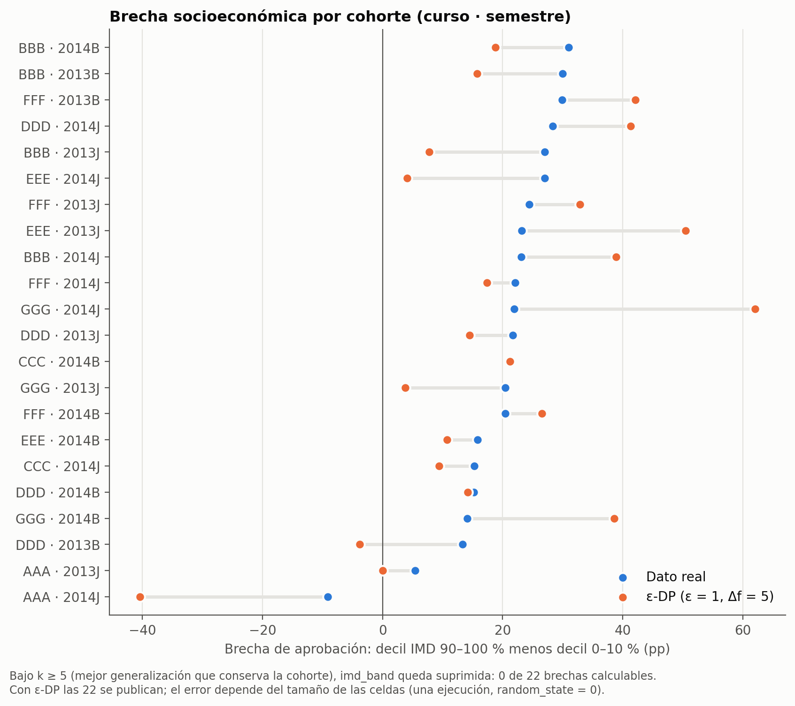
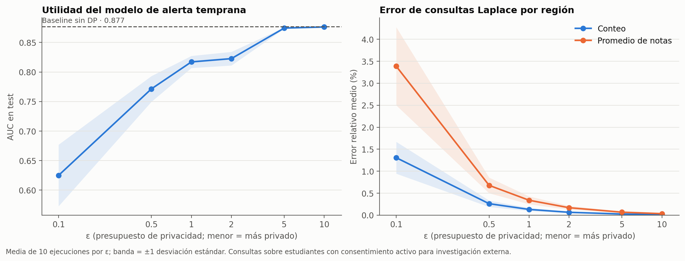

# Alerta Temprana de Deserción con Analítica Privatizada

## Informe técnico-ético final

**Curso:** DS3031 — Ética y Seguridad de Datos (Proyecto Tipo 1)
**Integrantes:** Valentina Álvarez Beraun · Luciana Yangali Cáceres
**Fecha:** noviembre de 2026
**Artefactos de soporte:** `notebooks/`, `backend/`, `frontend/`, `db/`

---

## Índice

1. Resumen ejecutivo
2. Evaluación de Impacto en la Protección de Datos (DPIA)
3. Privacidad Diferencial: implementación y resultados
4. Documentación de transparencia
5. Reflexión ética
6. Referencias

### Índice de figuras

| Figura | Contenido | Sección |
|---|---|---|
| 1 | Matriz de riesgos LINDDUN, antes y después de las medidas | 2.6 |
| 2 | $k$-anonimato y ataque de enlace | 3.1 |
| 3 | Brecha socioeconómica: dato real frente a $\epsilon$-DP | 3.1 |
| 4 | Curva privacidad–utilidad | 3.4 |
| 5 | Trilema privacidad–equidad | 3.4 |
| 6 | Error DP según el tamaño del grupo | 3.4 |
| 7 | Prueba de fuga de *proxies* | 5.3 |

---

## 1. Resumen ejecutivo

> **Conclusión principal.** El sistema es viable y se **aprueba con condiciones**. La privacidad diferencial protege a los estudiantes sin perder utilidad (AUC 0.874 frente a 0.877). El modelo mantiene brechas de equidad que vienen de los datos, por eso la alerta **solo puede ser un apoyo para un tutor humano**, nunca una decisión automática.

### 1.1 Caso de negocio

La deserción universitaria en el Perú afecta más a estudiantes de primera generación, de menores ingresos y con discapacidad. El apoyo funciona mejor cuanto antes llega, pero las notas finales llegan tarde.

La propuesta es una **plataforma de alerta temprana** que, con los datos de los **primeros 60 días** del ciclo:

1. Estima la probabilidad de que cada estudiante apruebe.
2. Ayuda a tutoría a decidir a quién ofrecer apoyo primero.
3. Explica al estudiante qué acciones mejorarían su situación.
4. Publica estadísticas agregadas **con privacidad diferencial** para investigadores, sin entregar microdatos.

### 1.2 Riesgos éticos

El sistema trata datos de jóvenes, incluido un **dato de salud** (discapacidad), en una relación de **asimetría de poder** con la universidad. Los riesgos centrales son:

- **Re-identificación** de personas en bases "anonimizadas".
- **Inferencia** de la discapacidad o del rendimiento.
- **Impacto dispar** sobre grupos vulnerables.
- **Opacidad**: no entender ni poder impugnar la evaluación.

### 1.3 Hallazgos clave

| Hallazgo | Evidencia |
|---|---|
| Seudonimizar no es anonimizar | Un ataque de enlace re-identifica al **22.4 %** del padrón con 100 % de precisión |
| El $k$-anonimato depende de lo que sabe el atacante | Con curso y semestre, **67.8 %** de las matrículas queda con $k < 5$ |
| $k$ no protege el dato sensible | **633 estudiantes** en grupos donde todos tienen discapacidad |
| Generalizar destruye el análisis | Con $k \geq 5$ se pierden **las 22** brechas socioeconómicas por cohorte |
| La DP conserva la utilidad | AUC **0.874** con $\epsilon = 5$ frente a 0.877 sin DP |
| Hay impacto dispar | $DI = 0.79$ (discapacidad) y $0.41$ (zona más pobre) |
| Quitar el atributo no basta | La conducta predice la discapacidad (AUC 0.56–0.59) |
| La DP no agrava las brechas | AUC igual para estudiantes con y sin discapacidad (0.874 / 0.873) |

### 1.4 Arquitectura implementada

```
 CSV OULAD ──► ETL 60 días ──► SQLite
                                ├─ oulad_analitico        (datos seudonimizados)
                                ├─ estudiantes_identidad  (identidad, separada)
                                ├─ consent_receipts       (consentimientos)
                                └─ audit_logs             (registro de consultas y ε)
                                        │
                          Backend FastAPI + diffprivlib
                                        │
                          Frontend Streamlit
                          ├─ Auditoría de riesgo
                          ├─ Simulador ε-DP y equidad
                          └─ Portal del estudiante
```

<details>
<summary>Ver endpoints del backend y sus controles</summary>

| Endpoint | Función | Control |
|---|---|---|
| `GET /stats/privatized` | Conteo y promedio por región o módulo con ruido | Solo estudiantes que consintieron; tope de $\epsilon = 10$ por periodo; cada consulta queda registrada |
| `POST /predict/student` | Probabilidad, nivel de alerta y explicaciones | Aviso del Art. 23 y revisión humana |
| `GET/POST /consent` | Consultar y registrar consentimiento | Recibo Kantara; botones Aceptar y Rechazar iguales |
| `POST /arco/revocar` | Revocar en un clic | Si la base es contractual, redirige al derecho de oposición |
| `GET /audit/logs` | Trazabilidad | El historial nunca se borra |

</details>

**Sobre los datos.** Se usa OULAD (Kuzilek et al., 2017), un dataset público de una universidad británica a distancia, como sustituto de datos peruanos. Nombres, DNI, correos y consentimientos son **sintéticos** (Faker).

---

## 2. Evaluación de Impacto en la Protección de Datos (DPIA)

> **En resumen.** Se identificaron 11 riesgos; **7 eran altos**. Con 18 medidas, **ninguno queda alto** y tres quedan en nivel medio (asimetría de poder, impacto dispar y seguridad aún no implementada). El dictamen es **aprobado con condiciones**.

### 2.1 Marco normativo

| Norma | Aspecto relevante |
|---|---|
| **Ley 29733** | Principios, datos sensibles (salud), consentimiento, derechos ARCO y **tratamiento objetivo (Art. 23)** |
| **DS 016-2024-JUS** | Oficial de Datos Personales, notificación de brechas en **48 h**, responsabilidad proactiva |
| **Ley 31814 y DS 115-2025-PCM** | IA con enfoque de riesgos, supervisión humana y no discriminación |
| **GDPR** (referencia) | Art. 9 (datos especiales), Art. 22 (decisiones automatizadas), Art. 35 (DPIA) |

Por prudencia, el sistema se trata como **IA de riesgo alto**, igual que los sistemas de evaluación educativa en el Reglamento Europeo de IA.

### 2.2 Paso 1 — Descripción del tratamiento

Cada finalidad tiene su propia base legal:

| Finalidad | Base legal | Quiénes | Datos |
|---|---|---|---|
| **F1. Alerta temprana** | Relación contractual educativa (Art. 14) | Todos los matriculados | Académicos, demográficos y conducta a 60 días. **Sin discapacidad.** |
| **F2. Investigación externa** | **Consentimiento expreso** y revocable | Solo quienes aceptan (65.2 %) | Solo agregados con DP, **nunca microdatos** |
| **F3. Auditoría de equidad** | Obligación de no discriminar | Todos, en entorno restringido | Incluye discapacidad **solo para medir sesgos** |

**Flujo resumido:** recolección (matrícula y aula virtual) → resumen de los primeros 60 días → identidad guardada aparte → entrenamiento con DP → predicción para tutor y estudiante → consultas agregadas con ruido → ejercicio de derechos.

<details>
<summary>Ver inventario de datos y actores</summary>

| Tabla | Contenido | Volumen |
|---|---|---|
| `estudiantes_identidad` | Nombre, DNI, correo | 28,785 estudiantes |
| `oulad_analitico` | Seudónimo, demografía, contexto académico, discapacidad y 5 variables de conducta | 32,593 matrículas |
| `consent_receipts` | Recibos por finalidad | 57,570 |
| `audit_logs` | Analista, consulta, $\epsilon$ gastado | Creciente |

| Actor | Rol y acceso |
|---|---|
| Universidad | Responsable del banco de datos |
| Oficial de Datos Personales | Supervisa, atiende derechos y notifica brechas |
| Tutor | Usa la alerta y **decide**; ve solo a sus tutorados |
| Investigador externo | Solo estadísticas agregadas con DP |
| Equipo de datos | Entrena y audita en entorno restringido |
| Estudiante | Ve su riesgo, sus recibos y ejerce sus derechos |

</details>

### 2.3 Paso 2 — Necesidad y proporcionalidad

Las decisiones de minimización más importantes:

- **Conducta a 60 días:** se guardan solo totales; 10.6 millones de clics se reducen a 2 cifras por estudiante.
- **Discapacidad:** **fuera del modelo**. Se conserva solo para auditar sesgos.
- **Identidad:** separada físicamente del resto.
- **Fecha de retiro:** excluida, porque revelaría el resultado.
- **Demografía** (región, género, edad, nivel socioeconómico): se mantiene porque mejora el modelo, pero las explicaciones nunca proponen cambiarla y se audita su impacto.

<details>
<summary>Ver evaluación de los 8 principios de la Ley 29733</summary>

| Principio | Estado | Evidencia |
|---|---|---|
| Legalidad | Cumple | Base legal por finalidad |
| Consentimiento | Cumple (F2) | *Opt-in* separado, revocable, con recibo |
| Finalidad | Cumple | F2 sin microdatos; usos punitivos prohibidos |
| Proporcionalidad | Cumple con observación | Demografía en revisión |
| Calidad | Parcial | Calibración peor para estudiantes con discapacidad |
| Seguridad | Parcial | Cifrado y control de acceso pendientes |
| Disposición de recurso | Cumple | Endpoints ARCO y oposición |
| Nivel de protección adecuado | Condicionado | Transferencias a la UE requieren SCC |

</details>

### 2.4 Paso 3 — Riesgos (LINDDUN)

Riesgo = probabilidad × impacto (escala 1–5): **bajo** 1–6, **medio** 8–12, **alto** 15–25. Los riesgos más graves:

| ID | Amenaza | Evidencia | Riesgo |
|---|---|---|---|
| R1 | Cruce con listas de clase para identificar personas | 22.4 % re-identificado | **25 Alto** |
| R2 | Registros únicos | 7,396 matrículas con $k = 1$ | **25 Alto** |
| R3 | Inferir discapacidad por grupo homogéneo | 633 estudiantes expuestos | **20 Alto** |
| R6 | El estudiante no sabe que es perfilado o no puede oponerse | Perfilado del 100 % | **16 Alto** |
| R11 | El modo demo muestra valores reales | Activado por defecto | **16 Alto** |
| R7 | Uso punitivo de la alerta e impacto dispar | $DI = 0.79$ y $0.41$ | **15 Alto** |
| R9 | Robo de la base de datos | SQLite sin cifrar | **15 Alto** |

<details>
<summary>Ver riesgos de nivel medio (R4, R5, R8, R10)</summary>

| ID | Amenaza | Riesgo |
|---|---|---|
| R4 | Promediar muchas consultas para quitar el ruido | 12 Medio |
| R8 | Consentimiento no libre por dependencia de la universidad | 12 Medio |
| R10 | No poder demostrar quién consultó qué | 9 Medio |
| R5 | Inferir discapacidad a través de la conducta | 8 Medio |

</details>

### 2.5 Paso 4 — Medidas de mitigación

**Implementadas en el prototipo:**

- **M1–M4. Privacidad diferencial:** solo agregados con ruido, presupuesto máximo por periodo, una fila por estudiante y modelo entrenado con DP que no se publica.
- **M5–M6. Minimización:** identidad separada y discapacidad fuera del modelo.
- **M7–M8. Consentimiento:** granular, simétrico, revocable en un clic y con recibo; para F1 se redirige al derecho de oposición.
- **M9. Explicaciones** accionables y aviso del Art. 23.
- **M10.** Interruptor para desactivar el modo demo.

**Pendientes para producción:**

- **M11–M13.** Autenticación y roles, cifrado y registros a prueba de manipulación.
- **M14.** **Revisión humana obligatoria** y prohibición de usos punitivos.
- **M15.** Presupuesto reducido: $\epsilon \leq 2$ por semestre.
- **M16–M18.** Plazos de retención, capacitación de tutores y protocolo de brechas en 48 h.

### 2.6 Paso 5 — Riesgo residual


*Figura 1. Riesgos R1–R11 antes (izquierda, 7 altos) y después de las medidas (derecha, 0 altos).*

**Lectura.**
- Las medidas bajan sobre todo la **probabilidad**; el **impacto** sigue igual, porque revelar una discapacidad seguiría siendo grave.
- Quedan en nivel medio **R6, R7 y R9**: dependen de la institución y de controles aún pendientes, no solo de la técnica.
- Como ningún riesgo queda alto, no se requiere consulta previa a la autoridad.

<details>
<summary>Ver tabla de riesgo residual</summary>

| ID | Medidas | Riesgo residual |
|---|---|---|
| R1, R2, R3 | M1, M5 | 5 Bajo |
| R4 | M2, M3, M15 | 6 Bajo |
| R5 | M4, M6 | 6 Bajo |
| R6 | M7, M8, M9, M14 | **8 Medio** |
| R7 | M6, M9, M14, M17 | **8 Medio** |
| R8 | M7, M8 | 6 Bajo |
| R9 | M5, M11, M12, M16, M18 | **10 Medio** |
| R10 | M2, M13 | 3 Bajo |
| R11 | M10 | 4 Bajo |

</details>

### 2.7 Paso 6 — Dictamen

**APROBADO CON CONDICIONES.** Antes de usar datos reales:

1. Desactivar el modo demo.
2. Implementar autenticación, roles y cifrado.
3. Política escrita: **la alerta nunca causa por sí sola** retiro, sanción ni pérdida de beca.
4. Presupuesto de consultas $\epsilon \leq 2$ por semestre.
5. Auditoría de equidad cada semestre; si el $DI$ por discapacidad baja de 0.75 o la brecha de FPR supera 8 pp, el modelo se suspende.

La DPIA es un documento vivo: se revisa cada semestre, ante cambios de datos o finalidades, tras cualquier incidente y al reentrenar el modelo.

### 2.8 Derechos del titular

- **Acceso:** el estudiante ve sus recibos y su propia evaluación.
- **Rectificación:** se corrige en el sistema académico y se actualiza en el siguiente ciclo.
- **Cancelación:** al revocar F2, el estudiante sale de inmediato de toda consulta futura.
- **Oposición:** para F1 se atiende ante el Oficial de Datos Personales.
- **Tratamiento objetivo (Art. 23):** aviso, explicación, revisión humana e impugnación.
- **Portabilidad:** exportación en JSON.

### 2.9 Brechas de seguridad

Protocolo: contener → evaluar el alcance con los registros → **notificar a la ANPD en 48 h** → avisar a los afectados (con prioridad si se expuso la discapacidad) → actualizar la DPIA.

Publicar la tabla seudonimizada sin DP sería, por sí mismo, una brecha notificable: el 22 % de los registros es re-identificable.

### 2.10 Comparación con el GDPR

| Aspecto | Perú | UE (GDPR) | Qué hace el sistema |
|---|---|---|---|
| Decisiones automatizadas | Art. 23 | Art. 22 y caso *SCHUFA* (C-634/21) | Revisión humana obligatoria |
| Explicación | Lógica del tratamiento | Caso *Dun & Bradstreet* (C-203/22) | Explicaciones en lenguaje simple |
| Notificación de brechas | 48 h | 72 h | Se adopta el plazo más estricto |
| Transferencias | Art. 15 | Perú sin decisión de adecuación | Cláusulas contractuales tipo si hay datos de estudiantes europeos |

---

## 3. Privacidad Diferencial: implementación y resultados

> **En resumen.** El $k$-anonimato falla: depende de lo que sabe el atacante y, cuando protege, destruye el análisis de equidad. La privacidad diferencial da una garantía que no depende del atacante. Se usan **$\epsilon = 0.5$ por consulta** (error menor a 1 %) y **$\epsilon = 5$ para el modelo** (pérdida de AUC de 0.002).

### 3.1 Por qué no basta con anonimizar

**$k$-anonimato según lo que sabe el atacante:**

| Lo que conoce el atacante | Matrículas únicas ($k = 1$) | % con $k < 5$ |
|---|---|---|
| Solo demografía | 0 | 0.0 % |
| Demografía + curso | 2,085 | 29.2 % |
| Demografía + curso + semestre | **7,396** | **67.8 %** |

OULAD se publicó cumpliendo $k \geq 5$, pero esa protección **desaparece con el contexto**: los compañeros de clase conocen el curso y el semestre.

**El dato sensible también se filtra.** Hay **561 grupos (633 estudiantes)** donde todos tienen discapacidad. Pertenecer a uno revela el dato de salud **sin identificar a nadie** ($t_{max} = 0.903$).


*Figura 2. Izquierda: tamaño de los grupos con solo demografía (azul) y con curso y semestre (naranja). Derecha: porcentaje re-identificado en cada caso.*

**Lectura.**
- Con solo demografía nadie queda expuesto.
- Al sumar curso y semestre, el ataque re-identifica a **665 de 2,972 personas (22.4 %)**: a 38 se les revela la discapacidad.
- Los datos no cambian; solo cambia lo que sabe el atacante.

**Generalizar no es la solución.** La mejor tabla con $k \geq 5$ obliga a eliminar región y nivel socioeconómico, y deja **0 de 22** brechas socioeconómicas calculables, cuando las reales llegan a 31 pp. Con DP sí se pueden publicar (Figura 3).



*Figura 3. Brecha de aprobación entre la zona más rica y la más pobre por cohorte. Azul: dato real; naranja: estimación con $\epsilon = 1$.*

**Lectura.**
- La DP conserva el patrón: la brecha es positiva en 19 de 22 cohortes (21 en el dato real).
- Algunas cohortes salen casi exactas y otras con errores de 30–40 pp: la DP confirma que la brecha existe, pero no la mide con exactitud en grupos pequeños.

### 3.2 Cómo funciona la DP

Un mecanismo es **$\epsilon$-diferencialmente privado** (Dwork et al., 2006) si su resultado casi no cambia al quitar o añadir a una persona:

$$P[\mathcal{M}(D) \in S] \;\le\; e^{\epsilon}\, P[\mathcal{M}(D') \in S]$$

Se usa el **mecanismo de Laplace**: se suma ruido de escala $\Delta f / \epsilon$, donde $\Delta f$ es cuánto puede cambiar el resultado por una sola persona. Como el ruido no depende del tamaño del grupo, **los grupos grandes casi no se ven afectados**.

Decisiones clave:
- **Una fila por estudiante**, para que la garantía sea por persona y no por matrícula.
- **Promedio = suma con ruido ÷ conteo con ruido**, sin gasto extra de privacidad.
- **Límites fijados de antemano** para escalar las variables, de modo que el preprocesamiento no filtre información.
- **Librería `diffprivlib`** (IBM): compatible con `scikit-learn` e incluye regresión logística con DP.

<details>
<summary>Ver derivación de la sensibilidad por consulta</summary>

| Consulta | Sensibilidad $\Delta f$ | Motivo |
|---|---|---|
| Conteo por región | 1 | Cada persona está en una sola región |
| Suma de notas | 100 | Nota acotada a $[0, 100]$ |
| Promedio por región | Sin costo extra | Se calcula a partir de suma y conteo |
| Histograma cohorte × nivel socioeconómico | 5 | Una persona puede tener hasta 5 matrículas |
| Regresión logística | $\sqrt{15} \approx 3.873$ | 8 variables en $[0,1]$ + 7 grupos *one-hot* |

Las regiones no se solapan, así que una consulta sobre las 13 cuesta lo mismo que sobre una sola. Conteo y suma se reparten $\epsilon/2$ cada uno.

</details>

### 3.3 Control del presupuesto de privacidad

- Cada consulta registra analista, consulta, $\epsilon$ gastado y hora.
- Si una consulta supera el tope del periodo ($\epsilon = 10$), el sistema la **rechaza** (error 403).
- El historial nunca se borra; el inicio de un nuevo periodo queda registrado.
- El modelo gasta su propio presupuesto ($\epsilon = 5$) una sola vez por entrenamiento.
- En la interfaz, mover el control de $\epsilon$ no gasta presupuesto; solo el botón de consultar.

### 3.4 Resultados

Se probaron seis valores de $\epsilon$ (0.1 a 10) con 10 repeticiones cada uno, sobre 6,489 matrículas de prueba.



*Figura 4. Izquierda: AUC del modelo según $\epsilon$ (línea discontinua: sin DP). Derecha: error de las consultas por región.*

**Lectura.**
- **Las consultas son baratas:** error menor a 3.4 % incluso con $\epsilon = 0.1$.
- **El modelo es caro:** pasa de AUC 0.62 ($\epsilon = 0.1$) a 0.874 ($\epsilon = 5$), casi igual que sin DP.
- Por eso se usan presupuestos distintos para cada uso.


*Figura 5. Izquierda: brechas de error entre estudiantes con y sin discapacidad. Derecha: pérdida de AUC de cada grupo (las curvas se superponen).*

**Lectura.**
- La DP **no castiga más** al grupo con discapacidad: ambas curvas son iguales.
- Con poco $\epsilon$ las brechas parecen bajar, pero es porque el modelo empeora para todos ("equidad por degradación").

<details>
<summary>Ver tabla completa de resultados por ε</summary>

| $\epsilon$ | AUC | Accuracy | AUC N | AUC Y | Brecha TPR (pp) | Brecha FPR (pp) | Error consultas % |
|---|---|---|---|---|---|---|---|
| 0.1 | 0.625 | 0.588 | 0.624 | 0.624 | 4.51 | 4.34 | 3.39 |
| 0.5 | 0.771 | 0.703 | 0.771 | 0.773 | 2.68 | 3.46 | 0.68 |
| 1 | 0.817 | 0.741 | 0.817 | 0.818 | 2.75 | 2.82 | 0.34 |
| 2 | 0.823 | 0.747 | 0.822 | 0.825 | 2.61 | 2.66 | 0.17 |
| **5** | **0.874** | **0.791** | **0.874** | **0.874** | **1.74** | **5.44** | **0.07** |
| 10 | 0.876 | 0.793 | 0.876 | 0.875 | 2.07 | 5.68 | 0.03 |
| Sin DP | 0.877 | 0.795 | 0.876 | 0.876 | 2.10 | 5.90 | 0 |

N = sin discapacidad, Y = con discapacidad. El error de consultas corresponde al promedio por región.

</details>

**El costo real de la DP está en los grupos pequeños:**


*Figura 6. Error de cada grupo cohorte × nivel socioeconómico según su tamaño, con $\epsilon = 1$. La línea discontinua es la curva teórica.*

| Personas en el grupo | Error típico |
|---|---|
| ≤ 50 | ~27 pp |
| 51–100 | ~15 pp |
| 101–200 | ~8 pp |
| > 200 | ~3 pp |

**Lectura.** Las cifras con DP son fiables desde unas 200 personas. Los grupos pequeños, que suelen ser los más vulnerables, reciben las cifras menos precisas.

### 3.5 Elección de $\epsilon$

Los criterios se fijaron **antes** de ver los resultados: AUC a menos de 0.02 del modelo sin DP, error de consultas ≤ 5 %, brechas que no crezcan más de 2 pp, y elegir el menor $\epsilon$ que cumpla todo.

| Uso | $\epsilon$ elegido | Por qué |
|---|---|---|
| Consultas agregadas | **0.5** | Ya con 0.1 cumple; 0.5 baja el error a 0.68 % y deja margen para grupos medianos |
| Modelo de alerta | **5** | Es el menor valor que mantiene la utilidad; con menos se **omiten alertas** a estudiantes en riesgo |

**Sobre $\epsilon = 5$.** Es una garantía teóricamente débil, pero se acepta porque:
- está en el rango de despliegues reales (Apple, Censo de EE. UU.);
- el modelo **no se publica**;
- la DP es una capa adicional, no la única protección;
- se gasta una sola vez por semestre.

En el peor caso, un estudiante que consintió F2 acumula $\epsilon = 15$ por periodo en la demo; en producción, con el tope reducido, $\epsilon \leq 7$.

### 3.6 Limitaciones

- **Punto flotante:** el Laplace estándar tiene una vulnerabilidad conocida (Mironov, 2012); en producción se recomienda el mecanismo `Snapping`.
- **Límites fijos:** si se recalcularan con los datos de cada ciclo, la garantía se perdería.
- **La DP no corrige sesgos:** protege a las personas, pero las brechas siguen igual.
- **Grupos pequeños:** con menos de ~100 personas las cifras son poco fiables.

---

## 4. Documentación de transparencia

> **En resumen.** El Datasheet advierte que los datos son británicos y de 2013–2014, así que el modelo **debe reentrenarse con datos peruanos** antes de usarse. El Model Card prohíbe cualquier uso punitivo y señala que la probabilidad es **menos fiable para estudiantes con discapacidad**.

### 4.1 Datasheet del dataset (Gebru et al., 2021)

- **Propósito:** entrenar un sistema de alerta temprana con datos de 60 días y responder consultas agregadas con DP.
- **Origen:** OULAD (Open University, Reino Unido; licencia CC BY 4.0). Las tablas de identidad y consentimiento son sintéticas.
- **Contenido:** 32,593 matrículas de 28,785 estudiantes, 7 cursos y 4 semestres; 19 variables.
- **Etiqueta:** aprobado (47.2 %) frente a desaprobado o retirado. Juntar ambos casos es una simplificación (ver 5.1).
- **Dato sensible:** discapacidad (9.7 %).
- **Grupos pequeños:** mayores de 55 años (216), con discapacidad (~3,160), nivel socioeconómico desconocido (1,111).
- **Preparación:** solo eventos de los primeros 60 días; se excluye la fecha de retiro; sin actividad registrada se imputa 0.
- **Consentimientos simulados:** 65.2 % acepta F2, asignado al azar.

**Advertencia de validez externa.** OULAD es una universidad a distancia con población adulta; una universidad presencial peruana es distinta. Antes de desplegar hay que reentrenar y re-auditar con equivalentes locales del nivel socioeconómico (INEI), la región (departamentos) y el uso del aula virtual.

**Usos no recomendados:** inferir características de estudiantes peruanos reales, re-identificar personas, usar la discapacidad como predictor o tomar decisiones administrativas.

### 4.2 Model Card (Mitchell et al., 2019)

| Campo | Valor |
|---|---|
| Modelo | Regresión logística con DP (`diffprivlib`), $\epsilon = 5$ |
| Entradas | 15 variables (53 dimensiones). **No usa discapacidad.** |
| Salida | Probabilidad de aprobar → alerta **alta** (< 0.40), **media** (0.40–0.60) o **baja** (≥ 0.60) |
| Rendimiento | AUC 0.874 · Accuracy 0.791 · F1 0.792 |
| Uso previsto | Que el tutor priorice a quién **ofrecer apoyo** entre las semanas 6 y 9 |

**Usos prohibidos:** retiro, sanción, pérdida de beca o restricción de matrícula basados en la alerta; decisiones sin revisión humana real; admisión o rankings; compartir puntajes con terceros; inferir la discapacidad de alguien.

**Principales hallazgos de equidad** (la clase positiva es "aprobará"):

- **Discapacidad:** $DI = 0.80$, en el límite de la regla 4/5. El grupo recibe **más** alertas, en parte porque su tasa real de aprobación es menor. Su probabilidad está **5 veces peor calibrada** (ECE 0.062 frente a 0.013): el tutor debe saberlo.
- **Nivel socioeconómico bajo:** $DI = 0.62$. Recibe más alertas innecesarias, con **riesgo de estigma**.
- **Género:** el modelo ordena peor a las mujeres (AUC 0.858 frente a 0.887) y omite más alertas en ese grupo (+5.4 pp).
- **DP frente a modelo sin DP:** diferencias ≤ 0.01; la DP **ni crea ni corrige** estas brechas.

<details>
<summary>Ver métricas desagregadas por subgrupo</summary>

| Subgrupo | n | Tasa real | TPR | FPR | AUC | ECE | DI |
|---|---|---|---|---|---|---|---|
| Sin discapacidad (ref.) | 5,884 | 0.491 | 0.834 | 0.254 | 0.874 | 0.013 | 1.000 |
| Con discapacidad | 605 | 0.374 | 0.816 | 0.199 | 0.873 | **0.062** | **0.798** |
| Hombres (ref.) | 3,643 | 0.466 | 0.831 | 0.225 | 0.887 | 0.021 | 1.000 |
| Mujeres | 2,846 | 0.497 | 0.834 | 0.279 | 0.858 | 0.026 | 1.094 |
| Nivel socioeconómico alto (ref.) | 1,671 | 0.551 | 0.874 | 0.337 | 0.854 | 0.021 | 1.000 |
| Nivel medio o desconocido | 2,753 | 0.515 | 0.850 | 0.270 | 0.869 | 0.018 | 0.900 |
| Nivel bajo | 2,065 | 0.376 | **0.751** | 0.173 | 0.886 | 0.024 | **0.617** |

Un FPR alto significa **alertas omitidas** (el error más dañino); un TPR bajo, **alertas innecesarias**.

</details>

**Limitaciones:** datos de otro país; la etiqueta mezcla desaprobación y retiro (probablemente infla el AUC); el modelo es lineal; los clics pueden penalizar a quien tiene mala conectividad.

**Explicaciones accionables.** El sistema prueba cambios en variables que el estudiante **sí puede mejorar** (entregas, días activos, clics, puntualidad, notas) y muestra las 3 de mayor efecto. Por ejemplo: *"Aumentar tus entregas de 2 a 4 elevaría tu probabilidad de aprobar en +28 puntos."* Nunca sugiere cambiar datos demográficos, no muestra coeficientes y se presenta como **estimación, no como promesa**.

---

## 5. Reflexión ética

> **En resumen.** Ninguna técnica resuelve sola un problema ético. La DP resuelve la re-identificación, pero la equidad y la autonomía del estudiante requieren **decisiones institucionales**: revisión humana, prohibición de usos punitivos y auditoría continua.

### 5.1 Ciclo de vida del dato

| Etapa | Riesgo principal | Control principal |
|---|---|---|
| **1. Adquisición** | Datos del aula virtual usados para otro fin; quienes consienten F2 pueden no ser representativos | Aviso claro desde la matrícula; informar el $n$ de cada estadística |
| **2. Preparación** | Juntar "se retiró por trabajo o salud" con "desaprobó"; fuga de información futura | Ventana estricta de 60 días; decisiones documentadas |
| **3. Almacenamiento** | Identidad y salud en el mismo archivo sin cifrar | Identidad separada; cifrado y roles (pendientes) |
| **4. Análisis** | Confundir correlación con causa; elegir $\epsilon$ a conveniencia | Criterios fijados antes; prueba de *proxies* |
| **5. Retención** | Guardar indefinidamente la conducta de egresados | Fin del ciclo + 1 año; reentrenar sin los datos borrados |
| **6. Intercambio** | Re-identificación al compartir (22.4 % demostrado) | Solo agregados con DP y presupuesto |

### 5.2 Validez del consentimiento

El estudiante depende de la universidad para su título y a veces su beca, así que un consentimiento para la alerta temprana **no sería realmente libre**. Por eso:

- **F1 no usa consentimiento**, sino la relación contractual, compensada con transparencia, derecho de oposición y revisión humana. El sistema **no ofrece un botón de "revocar" sin efecto real**.
- **F2 sí usa consentimiento**, porque negarse no tiene ninguna consecuencia académica.

| Condición | Cómo se cumple en F2 |
|---|---|
| Libre | Rechazar no tiene consecuencias |
| Específico | Un recibo por finalidad |
| Informado | Aviso por capas: resumen simple y detalle legal desplegable |
| Inequívoco | Botones Aceptar y Rechazar iguales, sin casillas pre-marcadas |
| Revocable | Un clic, efecto inmediato |

Cada decisión genera un **recibo Kantara** (antecedente de ISO/IEC TS 27560:2023) que el estudiante puede descargar y que permite a la universidad demostrar qué se consintió y cuándo.

### 5.3 Variables *proxy*

Quitar la discapacidad del modelo no basta si otras variables la revelan. Para comprobarlo, se intentó predecir la discapacidad usando **solo la conducta** de los primeros 60 días.


*Figura 7. Izquierda: capacidad de la conducta para predecir discapacidad y pobreza, frente a un control aleatorio. Derecha: información que aporta cada variable sobre la discapacidad.*

**Lectura.**
- La conducta predice ambos atributos mejor que el azar (AUC 0.56–0.59 frente a 0.50).
- La variable que más revela es **créditos matriculados**, probablemente porque reducir la carga es un ajuste común por discapacidad.
- La fuga es **moderada**: no permite adivinar la condición de una persona, pero sí arrastra sesgo al modelo.

**Conclusiones:**
1. Por esta fuga aparece $DI = 0.79$ **aunque la discapacidad no esté en el modelo**.
2. **Paradoja de la minimización:** para medir la discriminación hay que **conservar** el dato en un entorno restringido; borrarlo ocultaría el sesgo sin eliminarlo.
3. Se evita el **trato dispar** (usar el atributo), pero existe **impacto dispar**; la responsabilidad es detectarlo, documentarlo y mitigarlo.

### 5.4 Teorema de imposibilidad

Si los grupos tienen tasas de aprobación distintas, ningún modelo puede igualar a la vez calibración, falsos positivos y falsos negativos (Kleinberg et al., 2016; Chouldechova, 2017). Aquí las tasas difieren: 0.491 frente a 0.374 por discapacidad, y 0.551 frente a 0.376 por nivel socioeconómico.

Se observa en los resultados: el modelo ordena igual de bien a ambos grupos (AUC 0.876), pero sus errores y su calibración difieren.

**Decisión normativa:**
1. **Priorizar que ningún grupo tenga más estudiantes en riesgo sin alerta** (balance de FPR).
2. **No usar umbrales distintos por discapacidad**, porque exigiría usar el dato de salud al decidir. En su lugar, **bajar el umbral para todos**.
3. **Informar al tutor** de que la probabilidad es menos fiable para estudiantes con discapacidad.
4. Recibir más alertas solo es dañino si la alerta castiga. Como oferta de apoyo voluntario puede ser positivo; por eso la prohibición de usos punitivos es la condición central del dictamen.

### 5.5 Trilema privacidad–utilidad–equidad

Bagdasaryan et al. (2019) mostraron que la DP puede perjudicar más a los grupos pequeños (*the poor get poorer*). En este sistema:

- **No ocurre en el modelo:** el AUC de ambos grupos es igual en todo el rango de $\epsilon$, porque `diffprivlib` añade el ruido a los coeficientes y afecta a todos por igual.
- **La aparente mejora con poco $\epsilon$ no es equidad:** el modelo se vuelve casi aleatorio para todos.
- **Sí ocurre en las consultas finas:** los grupos de ≤ 50 personas tienen ~34 pp de error frente a ~3–5 pp en los de más de 200.

**Punto elegido:** privacidad formal por persona, pérdida de utilidad mínima (0.002 de AUC) y brechas de equidad **documentadas y gestionadas** con revisión humana, umbral protector, monitoreo semestral y prohibición de usos punitivos.

### 5.6 Trabajo futuro

1. Reentrenar y auditar con datos de una universidad peruana.
2. Evaluar solo a quienes siguen matriculados al día 60.
3. Probar un modelo sin género ni región.
4. Implementar autenticación, cifrado, registros encadenados y `Snapping`.
5. Probar con estudiantes la claridad del aviso y de las explicaciones.
6. Explorar mitigación de sesgo compatible con DP (Jagielski et al., 2019).

---

## 6. Referencias

<details>
<summary>Privacidad y anonimización</summary>

- Abowd, J. M., et al. (2022). The 2020 Census Disclosure Avoidance System TopDown Algorithm. *Harvard Data Science Review*, Special Issue 2.
- Apple Differential Privacy Team. (2017). *Learning with Privacy at Scale*. Apple Machine Learning Journal.
- Chaudhuri, K., Monteleoni, C., y Sarwate, A. D. (2011). Differentially private empirical risk minimization. *Journal of Machine Learning Research*, 12, 1069–1109.
- Dwork, C., McSherry, F., Nissim, K., y Smith, A. (2006). Calibrating noise to sensitivity in private data analysis. *Theory of Cryptography Conference (TCC)*, 265–284.
- Holohan, N., Braghin, S., Mac Aonghusa, P., y Levacher, K. (2019). Diffprivlib: The IBM Differential Privacy Library. *arXiv:1907.02444*.
- Li, N., Li, T., y Venkatasubramanian, S. (2007). t-Closeness: Privacy beyond k-anonymity and l-diversity. *IEEE ICDE*, 106–115.
- Machanavajjhala, A., Kifer, D., Gehrke, J., y Venkitasubramaniam, M. (2007). l-Diversity: Privacy beyond k-anonymity. *ACM TKDD*, 1(1).
- Mironov, I. (2012). On significance of the least significant bits for differential privacy. *ACM CCS*, 650–661.
- Samarati, P. (2001). Protecting respondents' identities in microdata release. *IEEE TKDE*, 13(6), 1010–1027.
- Sweeney, L. (2002). k-Anonymity: A model for protecting privacy. *International Journal of Uncertainty, Fuzziness and Knowledge-Based Systems*, 10(5), 557–570.
- Wilson, R. J., et al. (2020). Differentially private SQL with bounded user contribution. *Proceedings on Privacy Enhancing Technologies*, 2020(2), 230–250.
- Wuyts, K., y Joosen, W. (2015). *LINDDUN privacy threat modeling: a tutorial*. KU Leuven, CW Reports 685.

</details>

<details>
<summary>Equidad</summary>

- Bagdasaryan, E., Poursaeed, O., y Shmatikov, V. (2019). Differential privacy has disparate impact on model accuracy. *NeurIPS 32*.
- Chouldechova, A. (2017). Fair prediction with disparate impact: A study of bias in recidivism prediction instruments. *Big Data*, 5(2), 153–163.
- Feldman, M., Friedler, S. A., Moeller, J., Scheidegger, C., y Venkatasubramanian, S. (2015). Certifying and removing disparate impact. *ACM KDD*, 259–268.
- Jagielski, M., et al. (2019). Differentially private fair learning. *ICML*, 3000–3008.
- Kleinberg, J., Mullainathan, S., y Raghavan, M. (2016). Inherent trade-offs in the fair determination of risk scores. *arXiv:1609.05807* (ITCS 2017).

</details>

<details>
<summary>Documentación y datos</summary>

- Gebru, T., et al. (2021). Datasheets for datasets. *Communications of the ACM*, 64(12), 86–92.
- Kuzilek, J., Hlosta, M., y Zdrahal, Z. (2017). Open University Learning Analytics dataset. *Scientific Data*, 4, 170171.
- Mitchell, M., et al. (2019). Model cards for model reporting. *ACM FAT\**, 220–229.
- Kantara Initiative. (2018). *Consent Receipt Specification v1.1.0*. ISO/IEC TS 27560:2023, *Privacy technologies — Consent record information structure*.

</details>

<details>
<summary>Normativa y jurisprudencia</summary>

- Congreso de la República del Perú. (2011). Ley N.° 29733, Ley de Protección de Datos Personales.
- Ministerio de Justicia y Derechos Humanos. (2024). Decreto Supremo N.° 016-2024-JUS, Reglamento de la Ley N.° 29733.
- Congreso de la República del Perú. (2023). Ley N.° 31814, Ley que promueve el uso de la inteligencia artificial en favor del desarrollo económico y social del país.
- Presidencia del Consejo de Ministros. (2025). Decreto Supremo N.° 115-2025-PCM, Reglamento de la Ley N.° 31814.
- Parlamento Europeo y Consejo. (2016). Reglamento (UE) 2016/679, Reglamento General de Protección de Datos (GDPR).
- Comisión Europea. (2021). Decisión de Ejecución (UE) 2021/914 relativa a las cláusulas contractuales tipo.
- Parlamento Europeo y Consejo. (2024). Reglamento (UE) 2024/1689, de Inteligencia Artificial.
- TJUE. (2023). Asunto C-634/21, *OQ contra Land Hessen (SCHUFA Holding)*.
- TJUE. (2025). Asunto C-203/22, *CK contra Dun & Bradstreet Austria GmbH*.
- U.S. EEOC. (1978). *Uniform Guidelines on Employee Selection Procedures*, 29 CFR § 1607.4(D) (regla de los 4/5).

</details>
