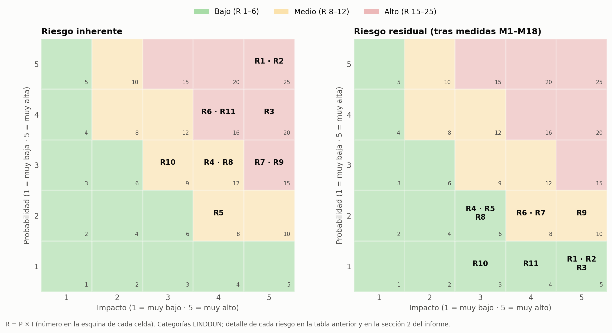
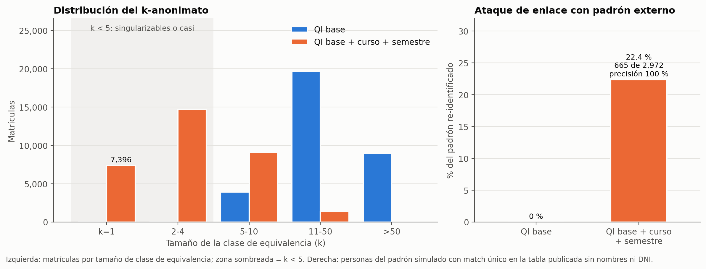
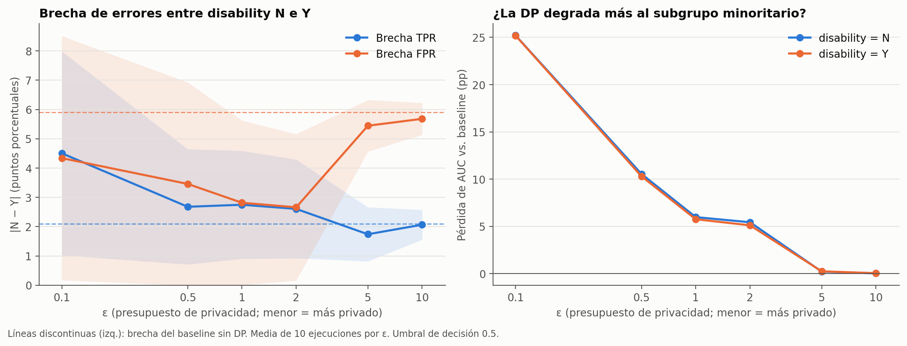
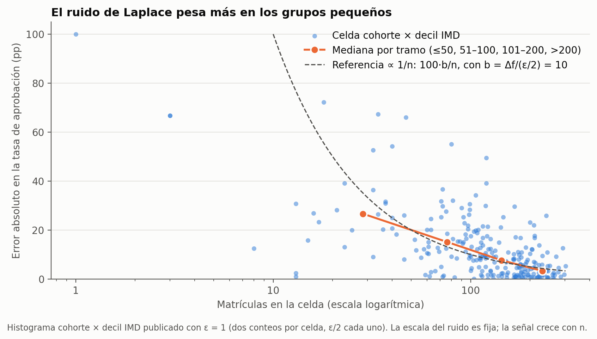
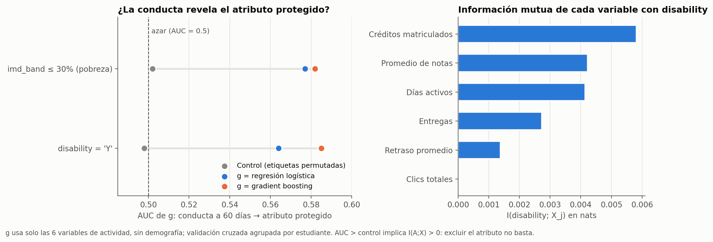

# Alerta Temprana de Deserción con Analítica Privatizada

## Informe técnico-ético final

**Curso:** DS3031 — Ética y Seguridad de Datos (Proyecto Tipo 1)
**Integrantes:** Valentina Álvarez Beraun · Luciana Yangali Cáceres
**Fecha:** noviembre de 2026
**Artefactos de soporte:** `notebooks/01_auditoria_riesgo_klt.ipynb`, `notebooks/02_experimentos_dp_y_equidad.ipynb`, `backend/`, `frontend/`, `db/`

---

## Índice

1. [Resumen ejecutivo y caso de negocio](#1-resumen-ejecutivo-y-caso-de-negocio)
2. [Evaluación de Impacto en la Protección de Datos (DPIA / EIPD)](#2-evaluación-de-impacto-en-la-protección-de-datos-dpia--eipd)
3. [Implementación y evaluación de Privacidad Diferencial](#3-implementación-y-evaluación-de-privacidad-diferencial-ε-dp)
4. [Documentación de transparencia](#4-documentación-de-transparencia)
5. [Reflexión ética integral](#5-reflexión-ética-integral)
6. [Referencias](#6-referencias)

### Índice de figuras

| Figura | Contenido | Sección | Fuente |
|---|---|---|---|
| 1 | Matriz de riesgos LINDDUN, inherente y residual | 2, paso 5 | Notebook 03 |
| 2 | Distribución del $k$-anonimato y ataque de enlace | 3.1 | Notebook 01 |
| 3 | Brecha socioeconómica por cohorte: real frente a $\epsilon$-DP | 3.1 | Notebook 01 |
| 4 | Curva privacidad–utilidad | 3.5 | Notebook 02 |
| 5 | Trilema privacidad–equidad | 3.5 | Notebook 02 |
| 6 | Error DP frente al tamaño de la celda | 3.5 | Notebook 01 |
| 7 | Prueba de fuga de *proxies* | 5.3 | Notebook 02 |

---

## 1. Resumen ejecutivo y caso de negocio

### 1.1 Contexto

La deserción en educación superior es un problema estructural en el Perú. Afecta con mayor intensidad a estudiantes de primera generación, de menores ingresos y con discapacidad. Las intervenciones de apoyo (tutoría, consejería, ajustes razonables) son más eficaces cuanto antes se aplican. Sin embargo, al cierre del ciclo el abandono ya ocurrió, y el registro de notas finales llega demasiado tarde.

El caso de negocio es una **plataforma universitaria de alerta temprana** que, con la información disponible en los **primeros 60 días** del ciclo, estima la probabilidad de que cada estudiante apruebe. El sistema:

1. Prioriza a quién ofrece apoyo el equipo de tutoría.
2. Explica al estudiante qué acciones concretas mejorarían su situación.
3. Ofrece a la institución y a investigadores externos estadísticas agregadas **con privacidad diferencial**, sin acceso a microdatos.

La ventana de 60 días es un compromiso deliberado. Es lo bastante temprana para intervenir y lo bastante larga para acumular señal conductual: entregas, notas tempranas y actividad en el aula virtual.

### 1.2 El problema ético

Un sistema de este tipo trata **datos personales de menores de edad y adultos jóvenes**, incluidos **datos sensibles de salud** (discapacidad), dentro de una relación de **fuerte asimetría de poder** entre la institución y el estudiante. Se identifican cuatro riesgos centrales:

- **Re-identificación:** que bases "anonimizadas" permitan identificar a una persona.
- **Inferencia de atributos sensibles:** deducir la discapacidad o el rendimiento de alguien.
- **Impacto dispar:** que el modelo trate peor a grupos vulnerables.
- **Opacidad:** que el estudiante no entienda ni pueda impugnar una evaluación automatizada.

### 1.3 Hallazgos clave

| Hallazgo | Evidencia | Fuente |
|---|---|---|
| Seudonimizar no es anonimizar | El ataque de enlace por cuasi-identificadores + curso + semestre re-identifica a **665 de 2,972 personas (22.4 %) con 100 % de precisión** | Notebook 01, §4 |
| El $k$-anonimato depende del adversario | Con 5 QI demográficos, $k_{min} = 5$. Al añadir curso y semestre, **7,396 matrículas con $k = 1$** y **67.8 % con $k < 5$** | Notebook 01, §2 |
| $k$ no protege el atributo sensible | **561 clases** (633 estudiantes) donde todos tienen discapacidad; $t_{max} = 0.903$ | Notebook 01, §3 |
| Generalizar destruye la utilidad | La mejor solución $k \geq 5$ que conserva la cohorte suprime región e IMD: **0 de 22** brechas socioeconómicas calculables (reales: hasta 31 pp) | Notebook 01, §5 |
| La DP conserva utilidad | Modelo DP con $\epsilon = 5$: **AUC 0.874** frente a 0.877 sin DP. Consultas por región con $\epsilon = 0.1$: error medio ≤ 3.4 % | Notebook 02, §4–5 |
| Existe impacto dispar | $DI = 0.79$ para discapacidad y $DI = 0.41$ para el decil IMD más pobre (incumple la regla 4/5) | Notebook 02, §1 |
| Quitar el atributo no basta | La conducta predice la discapacidad con AUC 0.56–0.59 frente a 0.50 del control: $I(A;X) > 0$ | Notebook 02, §2 |
| La DP no agrava las brechas | No se reproduce *the poor get poorer*: AUC N = 0.874 y AUC Y = 0.873 con $\epsilon = 5$ | Notebook 02, §4 |

**Dictamen DPIA:** el tratamiento se **aprueba con condiciones** (sección 2.6). La condición principal es que la alerta sea un insumo para un tutor humano y nunca una decisión automática con efectos sobre el estudiante.

### 1.4 Arquitectura técnica implementada

```
 CSV OULAD ──► db/build_oulad_db.py ──► SQLite (db/oulad_proyecto.db)
                (ETL ventana 60 días)      ├─ oulad_analitico        (seudonimizado, id_student)
 Faker ─────► db/enrich_db.py ──────────►  ├─ estudiantes_identidad  (identificadores directos, separados)
                                           ├─ consent_receipts       (Kantara, por finalidad)
                                           └─ audit_logs             (privacy accountant)
                                                   │
                                     backend/ (FastAPI + diffprivlib)
                                     ├─ dp_engine.py  Laplace · DP-LogReg ε=5 · contrafactuales
                                     ├─ main.py       endpoints + presupuesto ε + ARCO
                                     └─ models.py     esquemas Pydantic
                                                   │  HTTP/JSON
                                     frontend/app.py (Streamlit, componentes nativos)
                                     ├─ Pestaña 1  Auditoría de riesgo y ataque de enlace
                                     ├─ Pestaña 2  Simulador ε-DP y equidad
                                     └─ Pestaña 3  Portal del estudiante (consentimiento, ARCO, riesgo)
```

| Endpoint | Función | Control ético-legal |
|---|---|---|
| `GET /stats/privatized` | Conteo y promedio por región o módulo con ruido de Laplace | Solo estudiantes con consentimiento activo para `investigacion_externa`; presupuesto máximo de $\epsilon = 10$ por periodo; error 403 al excederlo; cada consulta registrada |
| `POST /predict/student` | Probabilidad de aprobar, nivel de alerta y explicaciones accionables | Aviso del Art. 23 (tratamiento objetivo) y revisión humana |
| `GET /consent/{id}`, `POST /consent` | Consulta y registro de consentimiento | Recibo Kantara; Aceptar y Rechazar simétricos |
| `POST /arco/revocar` | Revocación en un clic | `otorgado = 0`, `revocado_en = timestamp`; error 422 si la base es contractual (se redirige al derecho de oposición) |
| `GET /audit/logs`, `POST /audit/nuevo-periodo` | Trazabilidad y reinicio de periodo | El historial nunca se borra; el reinicio queda registrado como marca |

**Nota sobre los datos.** Se usa el *Open University Learning Analytics Dataset* (OULAD; Kuzilek et al., 2017) como **sustituto realista** de los datos de una universidad peruana. Es un dataset público de una universidad británica a distancia. Los identificadores directos (nombre, DNI, correo) y los recibos de consentimiento son **sintéticos**, generados con Faker. Las implicaciones de esta sustitución se documentan en el Datasheet (sección 4.1).

---

## 2. Evaluación de Impacto en la Protección de Datos (DPIA / EIPD)

### 2.0 Marco normativo aplicable

| Norma | Contenido relevante para el sistema |
|---|---|
| **Ley N.° 29733**, Ley de Protección de Datos Personales | Principios rectores (Arts. 4–11); datos sensibles, incluida la salud (Art. 2.5); consentimiento y sus excepciones (Arts. 13–14); flujo transfronterizo (Art. 15); seguridad (Art. 16); derechos del titular (Arts. 18–24), incluido el **derecho al tratamiento objetivo (Art. 23)** |
| **DS 016-2024-JUS**, nuevo Reglamento | Oficial de Datos Personales; notificación de incidentes de seguridad a la ANPD en **48 horas**; derechos ARCO más portabilidad y desindexación; evaluación de impacto y responsabilidad proactiva |
| **Ley N.° 31814** y su Reglamento, **DS 115-2025-PCM** | Promoción del uso de la IA con **enfoque basado en riesgos**, transparencia, supervisión humana y no discriminación |
| **GDPR** (referencia internacional) | Art. 5 (*accountability*), Art. 9 (categorías especiales), Art. 22 (decisiones únicamente automatizadas), Art. 33 (brechas en 72 h), Arts. 35–36 (DPIA y consulta previa), Arts. 44–46 (transferencias y SCC) |

Por prudencia, el sistema se trata como **IA de riesgo alto**: incide en la trayectoria educativa de las personas. Es la misma categoría que el Reglamento Europeo de IA asigna a los sistemas de evaluación educativa (Anexo III, punto 3). Por eso se aplican supervisión humana, registro, gestión de sesgos y transparencia.

---

### Paso 1 — Descripción sistemática del tratamiento

**1.a Inventario de datos**

| Tabla | Datos | Categoría | Volumen |
|---|---|---|---|
| `estudiantes_identidad` | `nombre_completo`, `dni`, `correo_institucional` | Identificadores directos | 28,785 estudiantes |
| `oulad_analitico` | `id_student` (seudónimo); `region`, `age_band`, `gender`, `highest_education`, `imd_band` (cuasi-identificadores); `code_module`, `code_presentation`, `studied_credits`, `num_of_prev_attempts` (contexto académico); `disability` (**dato sensible de salud**); 5 variables conductuales a 60 días; `target_aprobado` | Seudonimizados | 32,593 matrículas |
| `consent_receipts` | `receipt_id`, `id_student`, `finalidad`, `base_legal`, `otorgado`, `timestamp`, `revocado_en` | Metadatos de cumplimiento | 57,570 recibos (2 por estudiante) |
| `audit_logs` | `usuario_analista`, `consulta`, `epsilon_gastado`, `timestamp` | Registro de actividad | Creciente |

**1.b Finalidades y bases legales**

| Finalidad | Base legal | Población | Datos usados | Destinatarios |
|---|---|---|---|---|
| **F1. Alerta temprana académica** | Relación contractual educativa (Ley 29733, Art. 14). La prestación del servicio educativo incluye el seguimiento académico. | 100 % de matriculados | Contexto académico, demografía y conducta a 60 días. **Excluye `disability`**. | Tutor asignado y el propio estudiante |
| **F2. Investigación externa** | **Consentimiento expreso**, *opt-in* separado y revocable (Arts. 5 y 13) | Solo quienes consienten: 18,780 (65.2 %) | Agregados por región o módulo con $\epsilon$-DP; **nunca microdatos** | Investigadores externos (analistas autenticados) |
| **F3. Auditoría de equidad** | Cumplimiento de obligaciones de no discriminación y responsabilidad proactiva | 100 %, en entorno restringido | Incluye `disability` **solo para medir brechas** | Oficial de Datos Personales y comité de ética |

**1.c Flujo de datos**

1. **Recolección:** el sistema académico y el aula virtual (LMS) generan la matrícula, las evaluaciones y los clics.
2. **ETL a 60 días** (`build_oulad_db.py`): se agregan las variables de los días ≤ 60, se imputan faltantes y se excluye `date_unregistration` para evitar fuga de la etiqueta.
3. **Separación de identidad:** los identificadores directos viven en una tabla aparte, unida solo por `id_student`.
4. **Entrenamiento DP:** se usa una matrícula por estudiante y se consume $\epsilon = 5$ una vez. El modelo queda en `backend/artifacts/` y **no se publica**.
5. **Predicción:** el tutor o el estudiante consultan el riesgo. Se devuelven la probabilidad, el nivel de alerta y las explicaciones contrafactuales.
6. **Consultas agregadas:** el analista pide estadísticas. El backend filtra por consentimiento activo, añade ruido de Laplace, descuenta presupuesto y registra la consulta.
7. **Ejercicio de derechos:** el estudiante otorga o revoca el consentimiento y se emite un recibo Kantara.

**1.d Actores y responsabilidades**

| Actor | Rol | Acceso |
|---|---|---|
| Universidad | Titular del banco de datos (responsable) | — |
| Oficial de Datos Personales (ODP) | Supervisa el cumplimiento, atiende derechos ARCO y notifica brechas | Logs de auditoría e identidades, bajo justificación |
| Tutor académico | Usa la alerta para ofrecer apoyo; **decide** | Riesgo y explicaciones de sus tutorados |
| Analista o investigador externo | Consulta agregados | Solo `/stats/privatized` |
| Equipo de ciencia de datos | Entrena y audita el modelo | `oulad_analitico` en entorno restringido |
| Estudiante | Titular de los datos | Su propio riesgo, sus recibos y sus derechos |

---

### Paso 2 — Necesidad y proporcionalidad

**2.a Justificación por variable (principio de proporcionalidad, Art. 7)**

| Variable | ¿Necesaria para F1? | Decisión y justificación |
|---|---|---|
| `promedio_notas_60d`, `entregas_60d`, `retraso_promedio_60d` | Sí | Son los predictores más directos del rendimiento y los únicos **accionables** por el estudiante |
| `total_clics_60d`, `dias_activos_60d` | Sí, agregadas | Se agregan a la ventana de 60 días; **no se guarda el rastro clic a clic** (10.6 millones de eventos crudos se reducen a 2 cifras). Así se evita el rastreo continuo. |
| `code_module`, `code_presentation` | Sí | La tasa base varía mucho entre cursos. También son el eje operativo de la tutoría. |
| `studied_credits`, `num_of_prev_attempts`, `date_registration` | Sí | Indican la carga académica y la historia previa |
| `region`, `imd_band`, `age_band`, `gender`, `highest_education` | **Discutible** | Mejoran la calibración, pero son cuasi-identificadores y pueden codificar desigualdad estructural. **Se conservan en el modelo** con dos salvaguardas: (i) las explicaciones nunca proponen cambiarlas; (ii) se audita el impacto dispar. Se recomienda evaluar en el siguiente ciclo un modelo sin `gender` y sin `region` (sección 5.6). |
| `disability` | **No para predecir** | **Excluida del modelo** (minimización y dato sensible). Se conserva **solo** en el entorno de auditoría de equidad, porque sin ella el sesgo no se puede medir. |
| `nombre_completo`, `dni`, `correo` | No para el modelo | Se separan físicamente y solo se usan para contactar al estudiante |
| `date_unregistration` | No | **Excluida**: es información del futuro respecto al día 60 (fuga de etiqueta) |

**2.b Evaluación de los 8 principios rectores (Ley 29733, Arts. 4–11)**

| Principio | Cumplimiento | Evidencia |
|---|---|---|
| Legalidad | Cumple | Bases legales diferenciadas por finalidad (Paso 1.b) |
| Consentimiento | Cumple para F2 | *Opt-in* granular, botones simétricos, sin casillas pre-marcadas, revocable en un clic, recibo Kantara |
| Finalidad | Cumple | Los recibos registran la finalidad; F2 nunca recibe microdatos; el Model Card **prohíbe usos punitivos** |
| Proporcionalidad | Cumple con observación | Agregación a 60 días; `disability` excluida; demografía en revisión (2.a) |
| Calidad | Parcial | Imputaciones documentadas; ECE peor para `disability = 'Y'` (0.057 frente a 0.013), lo que afecta la exactitud para ese grupo |
| Seguridad | Parcial en la demo | DP, separación de identidad y logs. Cifrado y RBAC están propuestos para producción (Paso 4). |
| Disposición de recurso | Cumple | Endpoints ARCO y vía de oposición ante el ODP |
| Nivel de protección adecuado | Condicionado | Sin transferencias internacionales en la demo; cualquier flujo hacia o desde la UE exige SCC (2.9) |

---

### Paso 3 — Identificación y evaluación de riesgos (LINDDUN)

**Escalas.** La probabilidad (P) y el impacto (I) van de 1 (muy bajo) a 5 (muy alto). El nivel de riesgo es $R = P \times I$: **bajo** de 1 a 6, **medio** de 8 a 12 y **alto** de 15 a 25. Las probabilidades del riesgo inherente se estiman **como si** el sistema publicara la tabla seudonimizada sin las medidas del Paso 4. Donde fue posible, se calibraron con la evidencia empírica del Notebook 01.

| ID | Categoría LINDDUN | Amenaza concreta | Evidencia | P | I | R inherente |
|---|---|---|---|---|---|---|
| R1 | **Linking** | Cruce de `oulad_analitico` con listas de clase o perfiles externos por QI + curso + semestre | 22.4 % re-identificado con 100 % de precisión | 5 | 5 | **25 Alto** |
| R2 | **Identifying** | Singularización de registros únicos | 7,396 matrículas con $k = 1$ | 5 | 5 | **25 Alto** |
| R3 | **Data disclosure** | Inferencia de discapacidad por homogeneidad de clase, sin re-identificar a nadie | 633 estudiantes en clases 100 % `Y`; $t_{max} = 0.903$ | 4 | 5 | **20 Alto** |
| R4 | **Detecting** | Inferencia de pertenencia: saber si alguien está entre quienes consintieron F2 a partir de consultas repetidas | Sin presupuesto, el promedio de $n$ respuestas reduce el ruido a razón de $1/\sqrt{n}$ | 3 | 4 | **12 Medio** |
| R5 | **Data disclosure** | Inferencia de discapacidad por *proxies* conductuales dentro del modelo | AUC de $g$ = 0.585 | 2 | 4 | **8 Medio** |
| R6 | **Unawareness / unintervenability** | El estudiante no sabe que es perfilado o no puede oponerse ni impugnar | Perfilado sistemático del 100 % de matriculados | 4 | 4 | **16 Alto** |
| R7 | **Non-compliance** | Uso de la alerta para sancionar o retirar (desvío de finalidad); impacto dispar | $DI = 0.79$ (discapacidad) y $0.41$ (IMD 0–10 %) | 3 | 5 | **15 Alto** |
| R8 | **Non-compliance** | Consentimiento no libre por asimetría institucional | El estudiante depende de la universidad | 3 | 4 | **12 Medio** |
| R9 | **Data disclosure** | Acceso indebido a `estudiantes_identidad` o a la base completa (brecha) | SQLite sin cifrar en la demo | 3 | 5 | **15 Alto** |
| R10 | **Non-repudiation** (inverso: rendición de cuentas) | No poder demostrar quién consultó qué ni cuánto $\epsilon$ se gastó | — | 3 | 3 | **9 Medio** |
| R11 | **Data disclosure** | El modo pedagógico expone valores reales junto a los privatizados | `MODO_PEDAGOGICO = 1` por defecto | 4 | 4 | **16 Alto** |

---

### Paso 4 — Medidas de mitigación

**Estado:** ✅ implementado y probado en la demo · 🔶 propuesto para producción.

| Medida | Tipo | Riesgos | Estado |
|---|---|---|---|
| **M1.** Los analistas no reciben microdatos; solo agregados con $\epsilon$-DP (Laplace, $\Delta f$ explícito) | Técnica | R1, R2, R3 | ✅ |
| **M2.** *Privacy accountant*: máximo $\epsilon = 10$ por periodo y 5 por consulta; registro en `audit_logs`; error 403 al excederlo | Técnica | R4, R10 | ✅ |
| **M3.** Acotamiento de contribución: una fila por estudiante (garantía por persona, no por fila) | Técnica | R4 | ✅ |
| **M4.** Modelo entrenado con DP (`diffprivlib`, $\epsilon = 5$, `data_norm` analítico) y **no publicado** | Técnica | R4, R5 | ✅ |
| **M5.** Separación física de identificadores directos (`estudiantes_identidad`) | Técnica | R1, R9 | ✅ |
| **M6.** Exclusión de `disability` del modelo y auditoría de equidad desagregada | Técnica / organizativa | R5, R7 | ✅ |
| **M7.** Consentimiento granular por finalidad, simétrico, revocable en un clic, con recibo Kantara | Técnica / legal | R6, R8 | ✅ |
| **M8.** Bloqueo de la revocación para F1 (base contractual) con redirección al **derecho de oposición** ante el ODP | Legal | R6, R8 | ✅ |
| **M9.** Explicaciones contrafactuales accionables y aviso del Art. 23 con derecho a revisión humana | Técnica / legal | R6, R7 | ✅ |
| **M10.** Desactivar `MODO_PEDAGOGICO` (sin valores reales y sin endpoints `/demo`) | Configuración | R11 | ✅ disponible; 🔶 obligatorio en producción |
| **M11.** Autenticación de analistas y RBAC por mínimo privilegio. Hoy el campo `analista` es autodeclarado. | Técnica | R9, R10 | 🔶 |
| **M12.** Cifrado en reposo (SQLCipher o motor gestionado) y TLS en tránsito | Técnica | R9 | 🔶 |
| **M13.** Logs a prueba de manipulación: solo-anexar con encadenamiento de hashes | Técnica | R10 | 🔶 |
| **M14.** **Revisión humana obligatoria** de toda alerta antes de cualquier acción; prohibición contractual de usos punitivos | Organizativa | R6, R7 | 🔶 política; ✅ reflejado en el Model Card y en el aviso |
| **M15.** Presupuesto de producción reducido: $\epsilon \leq 2$ por semestre para consultas ($\epsilon = 0.5$ por consulta) | Organizativa | R4 | 🔶 |
| **M16.** Retención: datos conductuales hasta el fin del ciclo + 1 año; reentrenamiento como máximo semestral; borrado verificable en *backups* | Organizativa | R9 | 🔶 |
| **M17.** Capacitación de tutores: la probabilidad es orientativa, el sesgo es conocido y el lenguaje no debe estigmatizar | Organizativa | R7 | 🔶 |
| **M18.** Procedimiento de notificación de brechas a la ANPD en 48 h (2.8) | Organizativa / legal | R9 | 🔶 |

---

### Paso 5 — Evaluación de riesgo residual

| ID | Medidas aplicadas | P | I | R residual | Justificación |
|---|---|---|---|---|---|
| R1 | M1, M5 | 1 | 5 | **5 Bajo** | Sin microdatos expuestos, el ataque de enlace no tiene tabla que cruzar |
| R2 | M1 | 1 | 5 | **5 Bajo** | La DP no publica registros individuales |
| R3 | M1 | 1 | 5 | **5 Bajo** | Las respuestas DP no dependen de forma significativa de una persona |
| R4 | M2, M3, M15 | 2 | 3 | **6 Bajo** | Garantía formal acotada por el presupuesto. Ver la nota sobre composición en 3.6. |
| R5 | M4, M6 | 2 | 3 | **6 Bajo** | El modelo no se publica; la fuga de los *proxies* es débil (AUC < 0.6) |
| R6 | M7, M8, M9, M14 | 2 | 4 | **8 Medio** | Persiste la asimetría institucional: un aviso claro no garantiza que se lea |
| R7 | M6, M9, M14, M17 | 2 | 4 | **8 Medio** | El impacto dispar es de origen estructural y **no se elimina**; se mitiga con revisión humana y prohibición de usos punitivos |
| R8 | M7, M8 | 2 | 3 | **6 Bajo** | El consentimiento solo se pide donde puede ser libre (F2) |
| R9 | M5, M11, M12, M16, M18 | 2 | 5 | **10 Medio** | Depende de controles 🔶 aún no implementados en la demo |
| R10 | M2, M13 | 1 | 3 | **3 Bajo** | — |
| R11 | M10 | 1 | 4 | **4 Bajo** | Siempre que la configuración de producción se verifique |



*Figura 1. Matriz probabilidad × impacto de los riesgos R1–R11. Izquierda: riesgo inherente (7 riesgos altos). Derecha: riesgo residual tras las medidas M1–M18 (0 altos). Fuente: `notebooks/03_matriz_riesgos_dpia.ipynb`.*

**Lectura.**
- **Antes de las medidas:** 7 de los 11 riesgos están en la zona alta, concentrados en la esquina superior derecha. R1 y R2 (enlace y singularización) tienen probabilidad e impacto máximos.
- **Después de las medidas:** todos los riesgos bajan, pero casi solo en **probabilidad**; el impacto se mantiene. Las medidas hacen menos probable que ocurra el daño, pero no lo hacen menos grave: revelar una discapacidad seguiría siendo grave.
- **Riesgos que quedan en nivel medio:** R6, R7 y R9. Dependen de la asimetría institucional, del impacto dispar y de controles de seguridad aún no implementados, que no se resuelven con técnica sola.

**Conclusión del Paso 5.** Con las medidas propuestas **ningún riesgo residual es alto** (Figura 1). Por eso no se requiere consulta previa a la autoridad (equivalente al GDPR Art. 36). Quedan en nivel medio R6, R7 y R9. Para que se mantengan en ese nivel deben implementarse M11–M14 antes del despliegue real.

---

### Paso 6 — Dictamen y documentación

**Dictamen:** **APROBADO CON CONDICIONES.**

**Condiciones de despliegue:**
1. `MODO_PEDAGOGICO = 0` en todo entorno con datos reales.
2. Autenticación y RBAC para analistas (M11) y cifrado en reposo y en tránsito (M12) antes de cargar datos reales.
3. Política institucional escrita: **la alerta nunca desencadena por sí sola** retiro, sanción, pérdida de beca ni restricción de matrícula (M14).
4. Presupuesto de consultas de producción $\leq 2$ por semestre (M15).
5. Auditoría de equidad cada semestre con las métricas del Model Card. Si el $DI$ por discapacidad baja de 0.75 o la brecha de FPR supera 8 pp, el modelo se suspende y se revisa.

**Naturaleza viva del documento.** La DPIA se revisa (i) cada semestre, (ii) ante cualquier cambio de variables, finalidades o destinatarios, (iii) tras cualquier incidente de seguridad y (iv) al reentrenar el modelo. Así se cumple el principio de responsabilidad proactiva (*accountability*, GDPR Art. 5.2; DS 016-2024-JUS).

| Rol | Responsabilidad en la aprobación |
|---|---|
| Oficial de Datos Personales | Valida la DPIA y custodia el registro |
| Comité de ética institucional | Valida el uso previsto y los usos prohibidos |
| Responsable técnico | Certifica la implementación de las medidas M1–M18 |

---

### 2.7 Derechos del titular

| Derecho | Implementación |
|---|---|
| **Acceso** | `GET /consent/{id}` devuelve los recibos; `POST /predict/student` muestra al estudiante su propia evaluación |
| **Rectificación** | 🔶 Solicitud al ODP; los datos académicos se corrigen en el sistema fuente y se propagan en el siguiente ETL |
| **Cancelación (supresión)** | Para F2, la revocación excluye al estudiante de inmediato de toda consulta futura (filtro `revocado_en IS NULL`). Lo ya publicado con DP no se puede "retirar", pero la garantía DP acota lo que revela sobre la persona. Para F1, la supresión procede al terminar la relación contractual (M16). |
| **Oposición** | Para F1, como la base no es el consentimiento, la "revocación" se redirige al **derecho de oposición** ante el ODP (respuesta 422 con instrucciones). El ODP evalúa la situación particular del estudiante. |
| **Tratamiento objetivo (Art. 23)** | Aviso explícito, explicación accionable, revisión humana e impugnación |
| **Portabilidad** | 🔶 Exportación en JSON de los recibos y de las variables propias |
| **Desindexación** | No aplica: el sistema no publica datos en buscadores |

### 2.8 Procedimiento ante brechas de seguridad

1. Detección y contención, con revocación de credenciales.
2. Evaluación del alcance usando `audit_logs` y los registros del servidor.
3. **Notificación a la ANPD dentro de las 48 horas** desde que se conoce la brecha (DS 016-2024-JUS). Como referencia, el GDPR da 72 horas (Art. 33).
4. Comunicación a los titulares afectados si hay riesgo para sus derechos, prioritaria si se expuso `disability`.
5. Registro del incidente y actualización de esta DPIA.

El Notebook 01 muestra que la publicación de `oulad_analitico` sin DP **constituiría por sí misma una brecha notificable**: el 22 % de los registros es re-identificable.

### 2.9 Contraste con el GDPR

| Aspecto | Perú (Ley 29733 / DS 016-2024-JUS) | UE (GDPR) | Implicancia para el sistema |
|---|---|---|---|
| Responsabilidad proactiva | Reforzada por el nuevo reglamento | Art. 5.2 | DPIA viva y logs de auditoría |
| Datos de salud | Dato sensible (Art. 2.5); consentimiento por escrito salvo excepciones (Art. 13.6) | Categoría especial (Art. 9) | `disability` fuera del modelo; solo para auditoría |
| Decisiones automatizadas | Derecho al tratamiento objetivo (Art. 23) | Art. 22: derecho a no ser objeto de decisiones **únicamente** automatizadas con efectos significativos | Supervisión humana obligatoria. Según la jurisprudencia del TJUE (*SCHUFA*, C-634/21), un *score* que determina de forma decisiva la decisión de un tercero ya puede ser una "decisión" en el sentido del Art. 22; de ahí la condición 3 del dictamen. |
| Explicación | Información sobre la lógica | Arts. 13–15 y 22; *Dun & Bradstreet Austria* (C-203/22): explicar el procedimiento y los principios aplicados de forma inteligible | Contrafactuales en lenguaje simple en lugar de valores SHAP crudos |
| DPIA | Exigida por el reglamento para tratamientos de riesgo | Art. 35: obligatoria para perfilado sistemático y datos especiales a gran escala | Este documento |
| Consulta previa | — | Art. 36, si el riesgo residual es alto | No requerida (Paso 5) |
| Notificación de brechas | **48 h** a la ANPD | **72 h** a la autoridad | Se adopta el plazo más estricto |
| Transferencias internacionales | Art. 15: país con nivel adecuado o garantías | Arts. 44–46: **Perú no tiene decisión de adecuación** de la UE | Si estudiantes de intercambio europeos se tratan en servidores de Lima, se requieren **Cláusulas Contractuales Tipo (SCC, Decisión 2021/914)** |

---

## 3. Implementación y evaluación de Privacidad Diferencial ($\epsilon$-DP)

### 3.1 Por qué no basta con anonimizar: evidencia del Notebook 01

**Clasificación de atributos.**
- **Identificadores directos:** nombre, DNI, correo.
- **Seudónimo:** `id_student`.
- **Cuasi-identificadores (QI):** `region`, `age_band`, `gender`, `highest_education`, `imd_band`.
- **QI contextuales:** `code_module`, `code_presentation`.
- **Atributos sensibles:** `disability`, `target_aprobado`.

**$k$-anonimato.**

| Escenario | Clases | $k_{min}$ | Registros con $k = 1$ | % con $k < 5$ |
|---|---|---|---|---|
| QI base (matrículas) | 1,509 | 5 | 0 | 0.0 % |
| QI base + curso | 7,041 | 1 | 2,085 | 29.2 % |
| QI base + curso + semestre | 14,602 | 1 | **7,396** | **67.8 %** |

El *release* público de OULAD fue diseñado para cumplir $k \geq 5$ frente a los QI demográficos. Esa protección **no sobrevive al contexto**: el curso y el semestre de un estudiante no son secretos para sus compañeros. **El $k$-anonimato es relativo al modelo de adversario.**

**$l$-diversidad y $t$-cercanía.** Para un atributo binario, la distancia EMD entre la distribución de la clase y la global se reduce a $\lvert p_{clase} - p_{global} \rvert$.

| QI | Atributo | $p_{global}$ | % registros en clases $l = 1$ | $t_{max}$ | Clases con $t > 0.2$ |
|---|---|---|---|---|---|
| Base | `disability` | 0.097 | 47.95 % | 0.903 | 74 |
| Base + curso + semestre | `disability` | 0.097 | 72.80 % | 0.903 | 1,668 |
| Base | `target_aprobado` | 0.472 | 0.52 % | 0.528 | 384 |
| Base + curso + semestre | `target_aprobado` | 0.472 | 41.99 % | 0.528 | 10,793 |

Muchas clases con $l = 1$ en `disability` son homogéneas en "N" ($t \approx 0.097$) y revelan poco. La $t$-cercanía expone el caso grave: **561 clases (633 estudiantes) son 100 % `disability = 'Y'`**. Pertenecer a ellas equivale a revelar un dato de salud **sin que nadie sea re-identificado**.

**Ataque de enlace.** Se simuló un padrón externo de 2,972 personas con nombre y DNI. Con los QI base el ataque no logra ningún *match* único. Al añadir curso y semestre logra **665 re-identificaciones (22.38 %) con 100 % de precisión**: 38 víctimas con la discapacidad revelada y 335 con el resultado "no aprobado".



*Figura 2. Izquierda: matrículas por tamaño de clase de equivalencia con QI base frente a QI + curso + semestre; la zona sombreada marca k < 5. Derecha: porcentaje del padrón externo re-identificado en cada escenario. Fuente: Notebook 01, §7.*

**Lectura.**
- **Izquierda, QI base:** todas las matrículas (barras azules) están en clases de 5 o más personas; ninguna cae en la zona de riesgo.
- **Izquierda, QI + curso + semestre:** la distribución (barras naranjas) se desplaza hacia la izquierda. 7,396 matrículas quedan únicas (k = 1) y 14,707 en clases de 2 a 4.
- **Derecha:** la consecuencia práctica es que el ataque pasa de no re-identificar a nadie a re-identificar al 22.4 % del padrón.
- **Conclusión:** los datos son los mismos en ambos escenarios. Solo cambia lo que sabe el atacante, y eso basta para que una tabla "segura" se vuelva vulnerable.

**Generalización.** Se recorrió el retículo completo de generalización de dominio (Samarati, 2001): 1,458 nodos, de los cuales 371 alcanzan $k \geq 5$. La mejor solución que conserva la cohorte (curso × semestre) obliga a suprimir `region` e `imd_band`. Las celdas cohorte × IMD que se pueden responder bajan de 242 a 22. Las brechas socioeconómicas calculables bajan de **22 a 0**, y las reales llegan a 31 pp (BBB 2014B). **La protección por generalización destruye justo el análisis de equidad que exige esta DPIA.** Con $\epsilon$-DP, en cambio, las 22 brechas se pueden publicar (Figura 3).


*Figura 3. Brecha de aprobación entre el decil IMD más rico y el más pobre en cada cohorte (curso · semestre). Azul: dato real; naranja: estimación con $\epsilon = 1$ y $\Delta f = 5$. Bajo $k \geq 5$ ninguna de estas brechas es calculable. La distancia entre puntos es el error introducido por el ruido. Fuente: Notebook 01, §7.*

**Lectura.**
- **Dato real (azul):** la brecha es positiva en 21 de las 22 cohortes, la mayoría entre 15 y 31 pp. Los estudiantes de las zonas más pobres aprueban mucho menos.
- **Estimación DP (naranja):** conserva ese patrón general, con 19 de 22 brechas positivas.
- **Precisión por cohorte:** algunas estimaciones son casi exactas (CCC · 2014B, DDD · 2014B, con error ≤ 1 pp) y otras se desvían mucho (GGG · 2014J, AAA · 2014J, con error de 30 a 40 pp).
- **Conclusión:** con $\epsilon = 1$ y deciles, la DP permite afirmar que la brecha existe, pero no sirve para medirla cohorte por cohorte con exactitud. Aun así, es más que lo que deja el $k$-anonimato, que no permite calcular ninguna.

### 3.2 Fundamento teórico

Un mecanismo aleatorio $\mathcal{M}$ satisface **$\epsilon$-privacidad diferencial** (Dwork, McSherry, Nissim y Smith, 2006) si, para todo par de bases $D, D'$ que difieren en **una persona** y todo conjunto de resultados $S$:

$$P[\mathcal{M}(D) \in S] \;\le\; e^{\epsilon}\, P[\mathcal{M}(D') \in S]$$

La garantía **no depende del conocimiento auxiliar del atacante**. Esta es la diferencia de fondo con el $k$-anonimato: cualquier padrón externo, presente o futuro, queda cubierto.

El **mecanismo de Laplace** publica

$$\mathcal{M}(D) = f(D) + \text{Lap}\!\left(\frac{\Delta f}{\epsilon}\right), \qquad \Delta f = \max_{D \sim D'} \lVert f(D) - f(D') \rVert_1$$

donde $\Delta f$ es la **sensibilidad global**. El ruido tiene escala fija $b = \Delta f / \epsilon$, independiente de $n$. Por eso el error relativo decrece con el tamaño del grupo.

Se usan tres propiedades:
- **Post-procesamiento:** cualquier función de una salida DP sigue siendo DP sin costo adicional.
- **Composición secuencial:** varios mecanismos sobre las mismas personas suman sus $\epsilon$.
- **Composición paralela:** mecanismos sobre subconjuntos disjuntos cuestan el máximo de sus $\epsilon$, no la suma.

**Elección de `diffprivlib` (IBM; Holohan et al., 2019).**
- Es de código abierto, mantenida y con API compatible con `scikit-learn`.
- Incluye mecanismos (Laplace, Gaussiano, Snapping) y modelos DP listos. Su `LogisticRegression` implementa la perturbación de objetivo de Chaudhuri, Monteleoni y Sarwate (2011).
- Permite usar el **mismo motor** en el notebook y en el backend.
- OpenDP y Google DP están orientadas a consultas SQL y no ofrecen un clasificador equivalente con la misma API.

### 3.3 Derivación de la sensibilidad

**Acotamiento de contribución.** Un estudiante puede tener hasta 5 matrículas. Para que la garantía sea **por persona** y no por fila, en las consultas y en el entrenamiento se conserva **una fila por estudiante** (Wilson et al., 2020).

| Consulta | Derivación | $\Delta f$ |
|---|---|---|
| **Conteo por región** | Cada persona aporta una fila y pertenece a una sola región: añadirla o quitarla cambia un conteo en 1 | $\Delta f_{conteo} = 1$ |
| **Suma de `promedio_notas_60d`** | La nota se acota a un dominio público $[0, 100]$: una persona cambia la suma como máximo en 100 | $\Delta f_{suma} = 100$ |
| **Promedio por región** | Un promedio directo tiene sensibilidad que depende de $n$ (que también es privado). Se calcula como $\widetilde{suma} / \widetilde{conteo}$, que es **post-procesamiento**. | — (costo 0) |
| **Histograma cohorte × IMD** (Notebook 01) | Sin acotar contribución, una persona aparece hasta en 5 celdas | $\Delta f = 5$ |
| **Regresión logística DP** | La sensibilidad depende de la norma L2 máxima de las filas (`data_norm`). Cada una de las 8 variables numéricas se escala a $[0,1]$ con **límites públicos fijados a priori**, y cada uno de los 7 grupos *one-hot* aporta exactamente un 1. | $\lVert x \rVert_2 \le \sqrt{8+7} = \sqrt{15} \approx 3.873$ |

Sobre `data_norm`: si se omite, `diffprivlib` lo estima con los datos y emite `PrivacyLeakWarning`, porque la norma máxima depende de un individuo concreto. Si se escala con el mínimo y máximo empíricos, el preprocesamiento mismo filtra información. La cota analítica $\sqrt{15}$ **no depende de los datos** y es ajustada: la norma máxima observada es 3.336.

**Presupuesto por consulta.** Las 13 regiones son disjuntas, así que se componen en **paralelo**. Conteo y suma son dos estadísticos sobre las mismas personas, así que se componen en **secuencia** con $\epsilon/2$ cada uno. Costo total por consulta: $\epsilon$.

Con $\epsilon = 1$: $b_{conteo} = 1/0.5 = 2$ y $b_{suma} = 100/0.5 = 200$. Sobre regiones de más de 700 personas esto produce un error medio de 0.14 % en el conteo y de 0.45 % en el promedio (Notebook 02, §3.2).

### 3.4 *Privacy accountant* en la aplicación

- Cada llamada a `/stats/privatized` registra en `audit_logs` el analista, la consulta, el $\epsilon$ gastado y la marca de tiempo.
- Antes de responder, el backend suma el $\epsilon$ consumido desde la última marca `RESET_PERIODO_PRESUPUESTO`. Si $\epsilon_{consumido} + \epsilon_{solicitado} > 10$, responde **403**.
- El inicio de un nuevo periodo se registra como una fila; **el historial nunca se borra**.
- El entrenamiento del modelo consume su propio presupuesto ($\epsilon = 5$) una sola vez y queda registrado como evento del sistema.
- En la interfaz, la consulta solo se ejecuta al pulsar un botón. Mover el *slider* no gasta presupuesto.

### 3.5 Resultados experimentales

Se probaron seis valores, $\epsilon \in \{0.1, 0.5, 1, 2, 5, 10\}$, con **10 ejecuciones por valor** y semillas distintas.

- **Partición:** agrupada por estudiante (`StratifiedGroupKFold`), sin solapamiento.
- **Entrenamiento:** 23,029 estudiantes.
- **Prueba:** 6,489 matrículas, de las cuales 605 tienen `disability = 'Y'`.


*Figura 4. Izquierda: AUC del modelo DP frente a $\epsilon$ (media ± 1 desviación estándar en 10 ejecuciones), con el baseline sin DP en línea discontinua. Derecha: error relativo medio (%) de las consultas de conteo y promedio por región.*

**Lectura.**
- **Modelo (izquierda):** el AUC sube de 0.62 con $\epsilon = 0.1$ a 0.874 con $\epsilon = 5$, casi igual al baseline. Entre $\epsilon = 1$ y $2$ casi no mejora. La banda se estrecha al aumentar $\epsilon$: el modelo, además de mejorar, se vuelve estable entre ejecuciones.
- **Consultas (derecha):** el error es mínimo en todo el rango: menor a 3.4 % incluso con $\epsilon = 0.1$, y menor a 1 % desde $\epsilon = 0.5$.
- **Conclusión:** proteger las consultas por región es barato y proteger el modelo es caro. Por eso se usan presupuestos distintos: 0.5 para las consultas y 5 para el modelo.



*Figura 5. Izquierda: brechas $\lvert N - Y \rvert$ de TPR y FPR frente a $\epsilon$, con el valor del baseline en línea discontinua; bandas = ±1 desviación estándar. Derecha: pérdida de AUC (pp) frente al baseline para cada subgrupo de discapacidad; las curvas se superponen.*

**Lectura.**
- **Brechas de error (izquierda):** la brecha de TPR entre N e Y se mantiene entre 2 y 4.5 pp. La de FPR baja con $\epsilon \leq 2$ (2.7–3.5 pp), pero con bandas muy anchas, y vuelve a ~5.5 pp con $\epsilon \geq 5$, igual que el baseline. La aparente mejora con poco $\epsilon$ es "equidad por degradación", no una mejora real.
- **Pérdida de AUC (derecha):** las curvas de ambos grupos son idénticas en todo el rango. La DP no castiga más al grupo con discapacidad, así que el efecto *the poor get poorer* no ocurre con este algoritmo.

| $\epsilon$ | AUC (media ± d.e.) | Accuracy | F1 | AUC N | AUC Y | Brecha TPR (pp) | Brecha FPR (pp) | Error conteo % | Error promedio % |
|---|---|---|---|---|---|---|---|---|---|
| 0.1 | 0.6249 ± 0.0521 | 0.588 | 0.579 | 0.624 | 0.624 | 4.51 | 4.34 | 1.31 | 3.39 |
| 0.5 | 0.7714 ± 0.0218 | 0.703 | 0.693 | 0.771 | 0.773 | 2.68 | 3.46 | 0.26 | 0.68 |
| 1 | 0.8171 ± 0.0102 | 0.741 | 0.736 | 0.817 | 0.818 | 2.75 | 2.82 | 0.13 | 0.34 |
| 2 | 0.8226 ± 0.0116 | 0.747 | 0.742 | 0.822 | 0.825 | 2.61 | 2.66 | 0.07 | 0.17 |
| **5** | **0.8743 ± 0.0011** | **0.791** | **0.792** | **0.874** | **0.874** | **1.74** | **5.44** | **0.03** | **0.07** |
| 10 | 0.8762 ± 0.0004 | 0.793 | 0.795 | 0.876 | 0.875 | 2.07 | 5.68 | 0.01 | 0.03 |
| Sin DP | 0.8766 | 0.795 | 0.797 | 0.876 | 0.876 | 2.10 | 5.90 | 0 | 0 |

**Interpretación.**

1. **Las consultas agregadas son casi gratuitas.** Incluso con $\epsilon = 0.1$ el error medio es ≤ 3.4 %. Cada región agrupa más de 700 personas, y la escala de ruido es pequeña frente a la señal.
2. **El modelo es mucho más sensible.** Publica un vector de 53 coeficientes, y el ruido se reparte entre todas las dimensiones. Hasta $\epsilon = 2$ pierde entre 5 y 25 pp de AUC. Desde $\epsilon = 5$ queda a menos de 0.3 pp del baseline, y su varianza entre ejecuciones cae un orden de magnitud.
3. **Los subgrupos pequeños sí sufren con la DP en consultas finas.** En el histograma cohorte × IMD del Notebook 01 ($\epsilon = 1$, $\Delta f = 5$), el error medio en la tasa de aprobación es de ~3–5 pp en celdas de más de 200 matrículas, pero de **~34 pp en celdas de ≤ 50**. Algunas brechas IMD individuales resultan poco fiables a esa granularidad. Este es el costo honesto de la DP, y se mitiga agregando a una granularidad proporcional (terciles IMD, curso sin semestre). La Figura 6 muestra que el error sigue la escala teórica $\propto 1/n$.



*Figura 6. Error absoluto en la tasa de aprobación de cada celda cohorte × decil IMD (242 celdas) frente a su tamaño, con $\epsilon = 1$. Naranja: mediana por tramo de tamaño. Línea discontinua: referencia $100 \cdot b / n$ con $b = \Delta f / (\epsilon/2) = 10$. Fuente: Notebook 01, §7.*

**Lectura.**
- **Tendencia:** cada punto es una celda, y el error cae a medida que la celda crece, siguiendo de cerca la curva teórica $1/n$.
- **Error mediano por tamaño de celda:**

  | Matrículas en la celda | Error mediano |
  |---|---|
  | ≤ 50 | ~27 pp |
  | 51–100 | ~15 pp |
  | 101–200 | ~8 pp |
  | > 200 | ~3 pp |

- **Causa:** el ruido tiene un tamaño fijo, mientras que la señal crece con el número de personas.
- **Consecuencia práctica:** las estadísticas DP solo son fiables para grupos de unas 200 personas o más, salvo que se gaste más presupuesto. Los grupos pequeños, que suelen ser los más vulnerables, son los que obtienen cifras menos precisas.

### 3.6 Selección cuantitativa de $\epsilon$

**Criterios fijados antes de mirar los resultados**, para no elegir $\epsilon$ a conveniencia:
1. AUC medio ≥ AUC baseline − 0.02.
2. Error relativo de consultas ≤ 5 %.
3. Brechas TPR y FPR ≤ baseline + 2 pp, es decir, la DP no amplifica la inequidad.
4. Entre los $\epsilon$ que cumplen, se elige **el menor**.

| $\epsilon$ | Utilidad modelo | Utilidad consultas | Equidad TPR | Equidad FPR | Cumple todo |
|---|---|---|---|---|---|
| 0.1 | ✗ | ✓ | ✗ | ✓ | ✗ |
| 0.5 | ✗ | ✓ | ✓ | ✓ | ✗ |
| 1 | ✗ | ✓ | ✓ | ✓ | ✗ |
| 2 | ✗ | ✓ | ✓ | ✓ | ✗ |
| **5** | ✓ | ✓ | ✓ | ✓ | **✓** |
| 10 | ✓ | ✓ | ✓ | ✓ | ✓ |

**Decisión: presupuestos diferenciados por mecanismo.**

| Mecanismo | $\epsilon$ | $e^{\epsilon}$ | Justificación |
|---|---|---|---|
| Consultas agregadas (F2) | **0.5** por consulta | 1.65 | $\epsilon = 0.1$ ya cumple el criterio (error 3.39 %). Con 0.5 el error baja a 0.68 % y queda margen para subgrupos medianos, manteniendo una garantía fuerte. |
| Modelo de alerta temprana (F1) | **5** | 148 | Es el menor valor que mantiene la utilidad sin amplificar brechas. Con $\epsilon \leq 2$ la pérdida de AUC (≥ 5 pp) se traduce en **alertas omitidas** a estudiantes en riesgo, un daño concreto que la privacidad no compensa. |

**Honestidad sobre $\epsilon = 5$.**
- Un factor $e^5 \approx 148$ es una garantía **débil en sentido teórico**.
- Se acepta por cuatro razones:
  1. Está en el rango de despliegues reales: Apple usa $\epsilon$ de 2 a 8 por día y el Censo de EE. UU. 2020 usó un total ≈ 17.
  2. El modelo **no se publica**; el único vector de ataque es la inferencia de pertenencia vía predicciones.
  3. F1 se ampara en una base contractual con controles organizativos. La DP es una **capa adicional** de defensa en profundidad, no la única barrera.
  4. Se consume una sola vez por reentrenamiento (como máximo semestral).

**Composición total y limitación reconocida.** Un estudiante que consintió F2 está expuesto, por composición secuencial, al modelo ($\epsilon = 5$) más las consultas del periodo. Con el tope de la demo ($\epsilon = 10$), la cota en el peor caso es $\epsilon = 15$ por periodo. **El tope de 10 es pedagógico**: permite varias consultas en una demostración en vivo. En producción se reduce a $\epsilon \leq 2$ por semestre (M15), lo que lleva la cota total a $\epsilon \leq 7$.

### 3.7 Limitaciones de la implementación DP

- **Aritmética de punto flotante.** Se usa el mecanismo de Laplace estándar de `diffprivlib`. La implementación ingenua en punto flotante es vulnerable a ataques sobre los bits menos significativos (Mironov, 2012). `diffprivlib` ofrece el mecanismo `Snapping` como alternativa robusta, y se recomienda usarlo en producción.
- **Dominios públicos.** Los límites de `LIMITES` (por ejemplo, 0–15 entregas o 0–10,000 clics) se fijaron por conocimiento del dominio. Si se recalcularan con los datos de cada ciclo, la garantía se rompería.
- **DP no corrige sesgos.** Protege a los individuos, pero las brechas de equidad del baseline se mantienen intactas con $\epsilon \geq 5$ (sección 5.5).
- **Ruido en subgrupos pequeños.** Las consultas sobre grupos de menos de ~100 personas producen estimaciones poco fiables. La interfaz debería advertirlo y el analista no debería sobreinterpretarlas.

---

## 4. Documentación de transparencia

### 4.1 Datasheet for Datasets (Gebru et al., 2021)

**Motivación**
- **Propósito:** entrenar y evaluar un sistema de alerta temprana de no aprobación con datos de los primeros 60 días, y servir de base para consultas agregadas con privacidad diferencial.
- **Creadores:** el dataset fuente, OULAD, fue publicado por la Open University (Reino Unido; Kuzilek, Hlosta y Zdrahal, 2017). La tabla derivada `oulad_analitico` y las tablas sintéticas fueron creadas por el equipo del proyecto para el curso DS3031.
- **Financiamiento:** académico, sin financiamiento externo.

**Composición**
- **Instancias:**
  - 32,593 matrículas (estudiante × módulo × semestre) de 28,785 estudiantes.
  - 7 módulos (AAA–GGG) y 4 semestres (2013B, 2013J, 2014B, 2014J).
- **Variables:** 19 columnas.
  - Demográficas: `gender`, `region` (13 regiones del Reino Unido), `highest_education`, `imd_band` (decil del índice de privación múltiple británico, por código postal), `age_band` (0–35, 35–55, 55+).
  - Académicas: `studied_credits`, `num_of_prev_attempts`, `date_registration`.
  - Sensible: `disability` (Y = 9.7 %).
  - Conductuales a 60 días: `promedio_notas_60d`, `entregas_60d`, `retraso_promedio_60d`, `total_clics_60d`, `dias_activos_60d`.
  - Etiqueta: `target_aprobado` y su fuente `final_result`.
- **Etiqueta:** `target_aprobado = 1` si `final_result` ∈ {Pass, Distinction} (47.2 %). Es 0 para Fail (7,052) y Withdrawn (10,156). Agrupar abandono y desaprobación es una decisión operacional (sección 5.1).
- **Subgrupos pequeños:** `age_band = 55+` (216 matrículas), `disability = 'Y'` (≈ 3,160) e `imd_band = Desconocido` (1,111). Las métricas sobre ellos tienen alta varianza.
- **Datos sintéticos añadidos:**
  - `estudiantes_identidad` (nombre, DNI de 8 dígitos y correo institucional ficticio) generada con Faker (configuraciones regionales es_CO, es_CL y es_MX, porque `es_PE` no está disponible).
  - `consent_receipts`: 100 % de recibos contractuales para F1, y para F2 un **65.2 % otorgado y 34.8 % no otorgado**, asignados al azar con semilla 42.
- **Datos sensibles:** `disability` es un dato de salud (Ley 29733, Art. 2.5). El rendimiento académico tiene impacto reputacional.

**Proceso de recolección y ETL a 60 días** (`db/build_oulad_db.py`)
1. Lectura de los CSV de OULAD tratando `""` y `"?"` como valores faltantes.
2. Unión con `studentRegistration` para obtener `date_registration`; **se excluye `date_unregistration`** porque revela el desenlace.
3. Evaluaciones con fecha ≤ 60: promedio de notas, número de entregas y retraso medio (entrega − fecha límite).
4. Actividad en el aula virtual: 10,655,280 eventos leídos en bloques de 500,000. Se agregan a clics totales y días activos distintos con fecha ≤ 60. Incluye actividad previa al inicio (días negativos), por lo que `dias_activos_60d` puede superar 60 (máximo 86).
5. Imputación: 0 para la actividad ausente (sin registro significa sin actividad); la mediana para 45 valores faltantes de `date_registration`; la categoría "Desconocido" para 1,111 valores faltantes de `imd_band`.
6. Salida en `data/processed/oulad_analitico.parquet` y en la tabla SQLite `oulad_analitico`, con 0 nulos.

**Preprocesamiento para modelado**
- Recorte a límites públicos y escalado a $[0,1]$; `log1p` en los clics; *one-hot* con el esquema público de categorías.
- Acotamiento a una matrícula por estudiante.
- Partición agrupada por estudiante.

**Usos recomendados**
- Investigación y docencia sobre analítica del aprendizaje con privacidad y equidad.
- Prototipado de sistemas de apoyo estudiantil con supervisión humana.

**Usos no recomendados**
- Inferir características de estudiantes peruanos reales: el dataset es británico, a distancia y de 2013–2014.
- Re-identificar a personas.
- Entrenar modelos que usen `disability` como predictor.
- Tomar decisiones administrativas sobre individuos.

**Validez externa (advertencia clave).** OULAD representa a una universidad británica a distancia con población mayoritariamente adulta. La distribución de una universidad presencial peruana será distinta ($P_{obs}(x) \neq P_{target}(x)$). Antes de desplegar se requiere reentrenar y re-auditar con datos locales. Tres variables necesitan un equivalente local: `imd_band` (por ejemplo, el nivel socioeconómico del INEI), `region` (departamentos) y los patrones de uso del aula virtual.

**Distribución.** OULAD se distribuye bajo licencia CC BY 4.0. Las tablas derivadas y la base SQLite **no se versionan** en el repositorio (`.gitignore`); se regeneran con los scripts.

**Mantenimiento.** El equipo del proyecto mantiene los scripts de ETL. Cualquier cambio de variables o de la ventana temporal requiere actualizar este Datasheet, el Model Card y la DPIA.

### 4.2 Model Card (Mitchell et al., 2019)

**Detalles del modelo**

| Campo | Valor |
|---|---|
| Nombre | Modelo de alerta temprana DP v1.0 |
| Tipo | Regresión logística con privacidad diferencial (`diffprivlib.models.LogisticRegression`; perturbación de objetivo, Chaudhuri et al., 2011) |
| Privacidad | $\epsilon = 5$; `data_norm` $= \sqrt{15}$; garantía por **persona** (una matrícula por estudiante) |
| Entradas | 8 numéricas acotadas + 7 categóricas *one-hot* (53 dimensiones). **No usa `disability`.** |
| Salida | Probabilidad de aprobar. Nivel de alerta: **alta** si < 0.40, **media** si 0.40–0.60, **baja** si ≥ 0.60 |
| Artefacto | `backend/artifacts/modelo_dp.joblib`; no se publica |
| Autoras | Valentina Álvarez Beraun, Luciana Yangali Cáceres (DS3031) |

**Uso previsto**
- **Usuarios:** tutores académicos y el propio estudiante.
- **Propósito:** priorizar el **ofrecimiento de apoyo** (tutoría, consejería, ajustes) entre la semana 6 y la 9 del ciclo.
- **Lectura:** la probabilidad es un **insumo orientativo** que un humano revisa.

**Usos prohibidos o fuera de alcance**
- ❌ Retiro, suspensión, sanción, pérdida de beca o restricción de matrícula basados en la alerta, **con o sin** intervención humana nominal.
- ❌ Cualquier decisión automática con efectos sobre el estudiante sin revisión humana sustantiva (Ley 29733, Art. 23; GDPR Art. 22).
- ❌ Admisión, selección de becarios o rankings de estudiantes.
- ❌ Compartir puntajes individuales con terceros (familia, empleadores, otras instituciones) sin base legal.
- ❌ Usar el modelo en otra población sin reentrenar y re-auditar (sección 4.1, validez externa).
- ❌ Inferir o etiquetar la discapacidad de un estudiante.

**Métricas globales** (partición de prueba agrupada por estudiante; DP = media de 10 ejecuciones)

| Modelo | AUC | Accuracy | F1 |
|---|---|---|---|
| Baseline sin DP | 0.8766 | 0.7946 | 0.7965 |
| **DP, $\epsilon = 5$** | **0.8743 ± 0.0011** | **0.7907** | **0.7924** |

**Métricas desagregadas por subgrupo** (umbral 0.5; DI respecto al grupo de referencia indicado; DP = media de 10 ejecuciones)

| Subgrupo | n | Tasa real | Tasa predicha | TPR | FPR | AUC | ECE | DI | Regla 4/5 |
|---|---|---|---|---|---|---|---|---|---|
| `disability = N` (ref.) | 5,884 | 0.491 | 0.538 | 0.834 | 0.254 | 0.874 | 0.013 | 1.000 | ✓ |
| `disability = Y` | 605 | 0.374 | 0.430 | 0.816 | 0.199 | 0.873 | **0.062** | **0.798** | ✗ |
| `gender = M` (ref.) | 3,643 | 0.466 | 0.507 | 0.831 | 0.225 | 0.887 | 0.021 | 1.000 | ✓ |
| `gender = F` | 2,846 | 0.497 | 0.555 | 0.834 | 0.279 | 0.858 | 0.026 | 1.094 | ✓ |
| IMD alto 70–100 % (ref.) | 1,671 | 0.551 | 0.632 | 0.874 | 0.337 | 0.854 | 0.021 | 1.000 | ✓ |
| IMD medio / desconocido | 2,753 | 0.515 | 0.569 | 0.850 | 0.270 | 0.869 | 0.018 | 0.900 | ✓ |
| IMD bajo 0–30 % | 2,065 | 0.376 | 0.390 | **0.751** | 0.173 | 0.886 | 0.024 | **0.617** | ✗ |

Con el baseline sin DP, el decil IMD 0–10 % tiene $DI = 0.413$, el más bajo de todos, y los deciles 10–80 % están entre 0.51 y 0.76 (Notebook 02, §1).

**Lectura operativa de los errores.** La clase positiva es "aprobará".
- Un **FPR alto** significa **alertas omitidas**: estudiantes que desaprobarán pero no reciben ayuda. Es el error más dañino para la finalidad del sistema.
- Un **TPR bajo** significa **alertas innecesarias**: estudiantes que aprobarán pero son marcados en riesgo. Generan estigma y consumen recursos de tutoría.

| Hallazgo | Implicancia |
|---|---|
| Discapacidad: $DI = 0.80$, en el límite. FPR más bajo (0.199 frente a 0.254). | El grupo Y recibe **más alertas**, no menos. Gran parte refleja la diferencia real de tasa base (cociente 0.76). |
| Discapacidad: ECE ≈ 5 veces mayor (0.062 frente a 0.013) | **La probabilidad mostrada es menos fiable para estudiantes con discapacidad.** El tutor debe saberlo. |
| IMD bajo: TPR 0.75 frente a 0.87 | Los estudiantes de menores recursos que sí aprobarán reciben más alertas innecesarias: **riesgo de estigma**. |
| IMD alto: FPR 0.34 frente a 0.17 | Los estudiantes de mayores recursos en riesgo reciben **menos alertas**. |
| Género: FPR F 0.279 frente a M 0.225; AUC F 0.858 frente a M 0.887 | El modelo ordena peor a las mujeres y omite más alertas en ese grupo (+5.4 pp). Debe monitorearse. |
| DP frente a baseline | Diferencias ≤ 0.01 en todas las métricas por subgrupo: **la DP no crea ni corrige** estas brechas. |

**Limitaciones conocidas**
- **Validez externa:** entrenado con OULAD (Reino Unido, a distancia, 2013–2014). Requiere reentrenamiento local.
- **Etiqueta compuesta:** "no aprobado" mezcla desaprobación (Fail) y abandono (Withdrawn). Los estudiantes que ya se retiraron antes del día 60 tienen actividad casi nula y son fáciles de predecir, lo que **probablemente infla el AUC**. En producción hay que evaluar solo a quienes siguen matriculados al día 60.
- **Calibración desigual:** peor para `disability = 'Y'`.
- ***Proxies*:** la conducta filtra información de discapacidad e IMD (sección 5.3).
- **Linealidad:** no captura interacciones. A cambio, es interpretable y compatible con DP.
- **Cobertura desigual del aula virtual:** los estudiantes con conectividad limitada registran menos clics por razones ajenas a su compromiso. La variable `total_clics_60d` puede penalizar la brecha digital.

**Diseño de explicaciones accionables (*reason codes* contrafactuales)**

La función `generar_explicacion_accionable` (`backend/dp_engine.py`):
1. Recorre **solo variables que el estudiante puede modificar**:

   | Variable | Escenario evaluado |
   |---|---|
   | Entregas | +2 |
   | Días activos | +10 |
   | Clics | ×1.5 + 100 |
   | Retraso | llevarlo a 0 |
   | Promedio | +10 |

2. Para cada una construye un escenario contrafactual de **una sola variable** y recalcula la probabilidad con el mismo modelo DP. Es post-procesamiento, sin costo de privacidad.
3. Conserva los cambios ≥ 0.5 pp y devuelve **los 3 de mayor efecto** en lenguaje simple. Por ejemplo: *"Aumentar tus entregas tempranas de 2 a 4 elevaría tu probabilidad estimada de aprobar en +28 puntos porcentuales."*
4. Si ninguna acción mejora la estimación, devuelve un mensaje de refuerzo ("mantener el ritmo").

**Principios de diseño**
- **Nunca** propone cambiar atributos demográficos. Esos atributos sí entran al modelo, pero no son accionables; recomendarlos sería absurdo y discriminatorio.
- No muestra valores SHAP ni coeficientes. Cumple el estándar de inteligibilidad de *Dun & Bradstreet Austria* (TJUE, C-203/22): explicar el procedimiento y los principios de forma comprensible.
- Se presenta como **estimación asociativa del modelo, no como promesa causal**. Siempre va acompañada del aviso del Art. 23 y del derecho a revisión humana.

---

## 5. Reflexión ética integral

### 5.1 Auditoría de las 6 etapas del ciclo de vida del dato

| Etapa | Riesgos concretos | Controles | Responsable |
|---|---|---|---|
| **1. Adquisición** | Uso de datos del aula virtual recolectados para gestionar el curso, no para predecir (limitación de propósito). Sesgo de muestreo: OULAD ≠ población peruana. **Sesgo de consentimiento:** las consultas F2 solo representan a quienes consienten (en la simulación fue al azar; en la realidad puede correlacionar con nivel socioeconómico o confianza institucional). | Aviso de privacidad por capas que declara F1 desde la matrícula. Bases legales separadas. Reentrenamiento con datos locales. Reportar el $n$ y la representatividad de F2 junto a cada estadística. | ODP; responsable de datos académicos |
| **2. Preparación** | **Definición operacional del target:** agrupar Withdrawn con Fail equipara "abandonó por trabajo o salud" con "desaprobó". Riesgo de fuga temporal. Imputar 0 confunde "sin datos" con "sin actividad". | Exclusión de `date_unregistration`. Ventana estricta ≤ 60 días. Imputación documentada en el Datasheet. Etiquetas derivadas de registros administrativos (sin *ghost work* de anotación manual). | Equipo de ciencia de datos |
| **3. Almacenamiento** | Confidencialidad: identidades y datos sensibles en el mismo archivo SQLite sin cifrar. Integridad: logs modificables. | Separación de `estudiantes_identidad` (✅). Cifrado en reposo, RBAC de mínimo privilegio y logs encadenados (🔶). Base excluida del control de versiones (✅). | Responsable técnico |
| **4. Análisis** | Confundir correlación con causalidad (los contrafactuales no son causales). *p-hacking* al elegir $\epsilon$ o el umbral. Uso de *proxies*. | Criterios de selección de $\epsilon$ **pre-registrados**. Partición agrupada por estudiante. Prueba de *proxies* con control permutado. Avisos de "estimación asociativa". | Equipo de ciencia de datos; comité de ética |
| **5. Retención** | Conservar indefinidamente la conducta de estudiantes egresados. Un modelo entrenado "recuerda" a quienes revocaron. | Plazo: fin del ciclo + 1 año para datos conductuales (🔶). Borrado verificable en *backups*. Revocación con efecto inmediato en consultas. **Desaprendizaje automático** mediante reentrenamiento semestral sin los registros suprimidos, más simple y verificable que *unlearning* aproximado. La DP acota además la influencia residual de cada persona en el modelo. | ODP; responsable técnico |
| **6. Intercambio** | Pérdida de control al compartir con investigadores externos; re-identificación (22.4 % demostrado). | **Solo agregados DP**, nunca microdatos. Presupuesto por periodo. Analistas autenticados (🔶). SCC si hay transferencia internacional. | ODP; comité de investigación |

### 5.2 Validez del consentimiento en el entorno universitario

**La asimetría institución–estudiante.** El estudiante depende de la universidad para su título, sus notas y a veces su beca. Un "consentimiento" para la alerta temprana **no sería libre**: negarse podría percibirse como arriesgado, y si la institución considera el seguimiento parte esencial del servicio, el consentimiento sería además ficticio. Por eso el diseño **no usa el consentimiento donde no puede ser libre**:

- **F1 (alerta temprana)** se ampara en la **relación contractual educativa** (Art. 14). En compensación, se garantiza transparencia plena (Art. 18), el derecho de oposición ante el ODP y el derecho al tratamiento objetivo (Art. 23). El sistema **rechaza la "revocación"** de F1 con un mensaje que explica la vía correcta. Esto evita la falsa sensación de control que daría un botón que no tiene efecto jurídico real.
- **F2 (investigación externa)** sí depende de un **consentimiento expreso**, porque no es necesaria para el servicio educativo y negarse no tiene ninguna consecuencia académica.

**Evaluación de F2 bajo las 5 condiciones de validez**

| Condición | Implementación | Evaluación |
|---|---|---|
| **Libre** | Rechazar no tiene consecuencias. F2 está desacoplada del servicio. | ✓ En la medida en que la institución lo garantice de hecho (M14). |
| **Específico** | Una finalidad por recibo; F1 y F2 separadas | ✓ |
| **Informado** | Aviso por capas: lenguaje simple arriba y detalle legal en un desplegable | ✓ Se recomienda una prueba de legibilidad con estudiantes reales. |
| **Inequívoco** | Acción afirmativa: botones **Aceptar** y **Rechazar** del mismo tamaño y estilo, sin casillas pre-marcadas, sin *dark patterns* | ✓ |
| **Revocable** | Un clic; efecto inmediato en las consultas futuras | ✓ Tan fácil como otorgarlo |

**Trazabilidad con recibos de consentimiento.** Cada decisión genera un recibo según la especificación *Consent Receipt* v1.1 de la Kantara Initiative, antecedente de la ISO/IEC TS 27560:2023. El recibo incluye versión del estándar, jurisdicción (PE), identificador único, marca de tiempo, método de recolección, responsable y contacto del ODP, URL y versión de la política, finalidad, base legal, estado (otorgado o revocado con fecha) y categorías sensibles involucradas.

- **Ventajas:** el estudiante puede descargarlo y la institución puede **demostrar** qué consintió cada persona y cuándo (responsabilidad proactiva).
- **Historial:** al cambiar una decisión, el recibo anterior se cierra y se emite uno nuevo; nunca se sobrescribe.

### 5.3 Variables *proxy*: por qué no basta con borrar el atributo

*Fairness through unawareness* supone que, si el atributo protegido $A$ no está entre las variables, el modelo no puede discriminar por él. Esto es falso si $I(A;X) > 0$. Para probarlo se entrenó un clasificador auxiliar $g: X_{comportamiento} \to A$ usando **solo** las seis variables de actividad, sin demografía.

| Atributo protegido | Prevalencia | AUC LogReg | AUC GradBoost | AUC control permutado | $\sum_j I(A; X_j)$ (nats) |
|---|---|---|---|---|---|
| `disability = 'Y'` | 0.097 | 0.564 | 0.585 | 0.498 | 0.0183 |
| `imd_band` ≤ 30 % (pobreza) | 0.322 | 0.577 | 0.582 | 0.502 | 0.0383 |

Las variables con más información sobre la discapacidad son `studied_credits` (0.0058 nats; probablemente carga académica reducida como ajuste), `promedio_notas_60d` (0.0042) y `dias_activos_60d` (0.0041).



*Figura 7. Izquierda: AUC del clasificador auxiliar $g$ (conducta a 60 días → atributo protegido) con dos algoritmos, frente al control con etiquetas permutadas y la línea de azar. Derecha: información mutua de cada variable conductual con `disability`. Fuente: Notebook 02, §7.*

**Lectura.**
- **AUC de $g$ (izquierda):** para ambos atributos, los dos clasificadores (0.56–0.59) quedan claramente a la derecha del control (~0.50). La conducta en los primeros 60 días sí contiene información sobre la discapacidad y la pobreza.
- **Magnitud:** la ventaja es moderada y está lejos de 1. Permite que el modelo arrastre un sesgo, pero no permite adivinar con fiabilidad la condición de una persona concreta.
- **Información mutua (derecha):** la variable que más revela es créditos matriculados, probablemente porque una carga académica reducida es un ajuste frecuente por discapacidad. Le siguen el promedio de notas y los días activos. Los clics no aportan información.
- **Conclusión:** quitar `disability` del modelo no es suficiente; hay que medir el sesgo de forma continua.

**Conclusiones**
1. $\text{AUC}(g) > 0.5$ de forma consistente frente al control permutado. La conducta temprana **contiene información** sobre la discapacidad y el nivel socioeconómico ($I(A;X) > 0$). Por eso el $DI = 0.79$ aparece **aunque `disability` no esté en el modelo**.
2. La fuga es **moderada**: no permite inferir la discapacidad de forma fiable a nivel individual. Esto limita el riesgo de privacidad (R5), pero no el de equidad.
3. **Paradoja de la minimización:** para auditar la discriminación por discapacidad hay que **conservar** el atributo en un entorno restringido. Borrarlo por completo ocultaría el sesgo sin eliminarlo. Se adopta una solución en dos niveles: `disability` fuera del modelo (minimización) y dentro del entorno de auditoría con acceso restringido al ODP y al comité (finalidad F3).
4. Distinción jurídica:
   - **Trato dispar:** uso directo del atributo. Se evita.
   - **Impacto dispar:** regla aparentemente neutral con efecto desproporcionado. Existe y se mide con la regla de 4/5.

   Sobre el impacto dispar, la responsabilidad del sistema es **detectarlo, documentarlo y mitigarlo**.

### 5.4 Teorema de imposibilidad aplicado a nuestras métricas

**Enunciado** (Kleinberg, Mullainathan y Raghavan, 2016; Chouldechova, 2017). Si las tasas base difieren entre grupos, ningún clasificador imperfecto puede cumplir a la vez:
- (i) calibración dentro de cada grupo;
- (ii) igualdad de FPR;
- (iii) igualdad de FNR (equivalente a igualdad de TPR).

**Nuestras tasas base difieren** de forma marcada:

| Atributo | Grupo | Tasa base de aprobación |
|---|---|---|
| Discapacidad | N | 0.491 |
| Discapacidad | Y | 0.374 |
| Nivel socioeconómico (IMD) | alto | 0.551 |
| Nivel socioeconómico (IMD) | bajo | 0.376 |

En consecuencia, el teorema se observa empíricamente:
- El modelo ordena igual de bien a ambos grupos (AUC N = Y = 0.876 en el baseline).
- Aun así, sus errores se distribuyen de forma distinta: brecha de FPR de 5.9 pp y DI de 0.79.
- Su calibración también difiere (ECE 0.013 frente a 0.057).
- Forzar FPR iguales mediante umbrales distintos por grupo **empeoraría la calibración**, y viceversa.

**Decisión normativa (no técnica).** Para un sistema **de apoyo**, el daño principal es la **alerta omitida** (FPR). Se propone:
1. **Priorizar el balance de FPR** como criterio de monitoreo: que ningún grupo tenga sistemáticamente más estudiantes en riesgo sin alerta.
2. **No usar umbrales diferenciados por discapacidad.** Requerirían usar el dato sensible en el momento de decidir, lo que es trato dispar y un tratamiento adicional de salud (Art. 13.6). La alternativa es **bajar el umbral global de alerta**: más estudiantes reciben una oferta de apoyo y el FPR de todos los grupos se reduce.
3. **Compensar la calibración desigual con información al tutor.** El Model Card declara que la probabilidad es menos fiable para el grupo Y, y la revisión humana es obligatoria.
4. **Reconocer la ambigüedad del daño.** Que el grupo IMD bajo reciba más alertas (TPR 0.75) solo es perjudicial si la alerta estigmatiza o restringe. Como intervención de apoyo voluntario puede ser incluso deseable. **Esa interpretación solo se sostiene si se cumple la prohibición de usos punitivos.** Por eso es la condición central del dictamen.

### 5.5 Trilema Privacidad–Utilidad–Equidad

Bagdasaryan, Poursaeed y Shmatikov (2019) mostraron que la DP puede producir un efecto ***the poor get poorer***: los subgrupos subrepresentados pierden más precisión. La razón es que el recorte de gradientes en DP-SGD penaliza más a los ejemplos atípicos. Se verificó si el efecto ocurre en nuestro sistema:

| Pregunta | Resultado | Interpretación |
|---|---|---|
| ¿La DP degrada más al grupo `disability = 'Y'`? | **No.** AUC N y AUC Y son prácticamente idénticos en todo el rango de $\epsilon$ (por ejemplo, 0.874 y 0.874 con $\epsilon = 5$; 0.624 y 0.624 con $\epsilon = 0.1$). | `diffprivlib` usa **perturbación de objetivo en un modelo lineal convexo**, no DP-SGD. El ruido se añade a los coeficientes y afecta a todos por igual. El efecto **depende del algoritmo DP**; es un resultado negativo honesto, no una refutación general. |
| ¿La DP reduce las brechas? | Con $\epsilon \leq 2$ la brecha de FPR media baja de 5.9 a 2.7–3.5 pp, con alta variabilidad entre ejecuciones (bandas de 0 a ~8 pp en la Figura 5). | Es **"equidad por degradación"**: el modelo se vuelve tan ruidoso que trata a todos de forma casi aleatoria (AUC 0.62–0.82). Una brecha pequeña con la utilidad destruida **no es equidad**: más estudiantes en riesgo quedan sin alerta en **todos** los grupos. |
| Con el $\epsilon$ elegido, ¿cambia la equidad? | Con $\epsilon = 5$, las brechas vuelven a las del baseline (TPR 1.7 pp, FPR 5.4 pp). | **La inequidad viene de los datos y de la estructura social, no de la DP.** La DP ni la crea ni la corrige. |
| ¿Dónde sí aparece el trilema? | En las **consultas finas**: con $\epsilon = 1$, las celdas cohorte × IMD de ≤ 50 personas tienen ~34 pp de error frente a ~3–5 pp en celdas de más de 200 (Notebook 01). | Los subgrupos pequeños (a menudo los vulnerables) obtienen **estadísticas menos precisas**. Medir la desigualdad que los afecta cuesta más presupuesto. Esta es la forma concreta del trilema en nuestro sistema. |

**Síntesis del trilema.** Los tres vértices no se pueden maximizar a la vez, pero el sistema elige un punto defendible:
- **Privacidad:** garantía formal por persona e independiente del adversario. Fuerte para las consultas ($\epsilon = 0.5$) y moderada para el modelo ($\epsilon = 5$), que no se publica.
- **Utilidad:** el modelo pierde 0.002 de AUC y las consultas regionales tienen errores menores a 1 %.
- **Equidad:** la DP no la degrada. Las brechas preexistentes se **documentan y gestionan** con revisión humana, umbral global protector, monitoreo semestral y prohibición de usos punitivos. La técnica no las resuelve sola.

La lección de fondo es que **ninguna técnica resuelve sola un problema ético**. La DP resuelve bien la re-identificación, que el $k$-anonimato no podía resolver sin destruir el análisis. La equidad y la autonomía del estudiante requieren además decisiones normativas explícitas, supervisión humana y gobernanza institucional.

### 5.6 Trabajo futuro

1. Reentrenar y re-auditar con datos de una universidad peruana, con equivalentes locales de `imd_band` y `region`.
2. Evaluar solo a los estudiantes matriculados al día 60 para corregir el sesgo de la etiqueta compuesta.
3. Comparar el modelo actual con uno sin `gender` ni `region` (minimización adicional) y medir el costo en AUC y en equidad.
4. Implementar M11–M13 (autenticación, cifrado, logs encadenados) y el mecanismo `Snapping`.
5. Hacer pruebas de usabilidad del aviso de privacidad y de las explicaciones contrafactuales con estudiantes.
6. Explorar mecanismos de mitigación de sesgo compatibles con DP, como la optimización restringida de Jagielski et al. (2019).

---

## 6. Referencias

**Privacidad y anonimización**
- Abowd, J. M., et al. (2022). The 2020 Census Disclosure Avoidance System TopDown Algorithm. *Harvard Data Science Review*, Special Issue 2.
- Apple Differential Privacy Team. (2017). *Learning with Privacy at Scale*. Apple Machine Learning Journal.
- Chaudhuri, K., Monteleoni, C., y Sarwate, A. D. (2011). Differentially private empirical risk minimization. *Journal of Machine Learning Research*, 12, 1069–1109.
- Dwork, C., McSherry, F., Nissim, K., y Smith, A. (2006). Calibrating noise to sensitivity in private data analysis. *Theory of Cryptography Conference (TCC)*, 265–284.
- Holohan, N., Braghin, S., Mac Aonghusa, P., y Levacher, K. (2019). Diffprivlib: The IBM Differential Privacy Library. *arXiv:1907.02444*.
- Li, N., Li, T., y Venkatasubramanian, S. (2007). t-Closeness: Privacy beyond k-anonymity and l-diversity. *IEEE ICDE*, 106–115.
- Machanavajjhala, A., Kifer, D., Gehrke, J., y Venkitasubramaniam, M. (2007). l-Diversity: Privacy beyond k-anonymity. *ACM TKDD*, 1(1).
- Mironov, I. (2012). On significance of the least significant bits for differential privacy. *ACM CCS*, 650–661.
- Samarati, P. (2001). Protecting respondents' identities in microdata release. *IEEE TKDE*, 13(6), 1010–1027.
- Sweeney, L. (2002). k-Anonymity: A model for protecting privacy. *International Journal of Uncertainty, Fuzziness and Knowledge-Based Systems*, 10(5), 557–570.
- Wilson, R. J., et al. (2020). Differentially private SQL with bounded user contribution. *Proceedings on Privacy Enhancing Technologies*, 2020(2), 230–250.
- Wuyts, K., y Joosen, W. (2015). *LINDDUN privacy threat modeling: a tutorial*. KU Leuven, CW Reports 685.

**Equidad**
- Bagdasaryan, E., Poursaeed, O., y Shmatikov, V. (2019). Differential privacy has disparate impact on model accuracy. *NeurIPS 32*.
- Chouldechova, A. (2017). Fair prediction with disparate impact: A study of bias in recidivism prediction instruments. *Big Data*, 5(2), 153–163.
- Feldman, M., Friedler, S. A., Moeller, J., Scheidegger, C., y Venkatasubramanian, S. (2015). Certifying and removing disparate impact. *ACM KDD*, 259–268.
- Jagielski, M., et al. (2019). Differentially private fair learning. *ICML*, 3000–3008.
- Kleinberg, J., Mullainathan, S., y Raghavan, M. (2016). Inherent trade-offs in the fair determination of risk scores. *arXiv:1609.05807* (ITCS 2017).

**Documentación y datos**
- Gebru, T., et al. (2021). Datasheets for datasets. *Communications of the ACM*, 64(12), 86–92.
- Kuzilek, J., Hlosta, M., y Zdrahal, Z. (2017). Open University Learning Analytics dataset. *Scientific Data*, 4, 170171.
- Mitchell, M., et al. (2019). Model cards for model reporting. *ACM FAT\**, 220–229.
- Kantara Initiative. (2018). *Consent Receipt Specification v1.1.0*. ISO/IEC TS 27560:2023, *Privacy technologies — Consent record information structure*.

**Normativa y jurisprudencia**
- Congreso de la República del Perú. (2011). Ley N.° 29733, Ley de Protección de Datos Personales.
- Ministerio de Justicia y Derechos Humanos. (2024). Decreto Supremo N.° 016-2024-JUS, Reglamento de la Ley N.° 29733.
- Congreso de la República del Perú. (2023). Ley N.° 31814, Ley que promueve el uso de la inteligencia artificial en favor del desarrollo económico y social del país.
- Presidencia del Consejo de Ministros. (2025). Decreto Supremo N.° 115-2025-PCM, Reglamento de la Ley N.° 31814.
- Parlamento Europeo y Consejo. (2016). Reglamento (UE) 2016/679, Reglamento General de Protección de Datos (GDPR).
- Comisión Europea. (2021). Decisión de Ejecución (UE) 2021/914 relativa a las cláusulas contractuales tipo.
- Parlamento Europeo y Consejo. (2024). Reglamento (UE) 2024/1689, de Inteligencia Artificial.
- TJUE. (2023). Asunto C-634/21, *OQ contra Land Hessen (SCHUFA Holding)*.
- TJUE. (2025). Asunto C-203/22, *CK contra Dun & Bradstreet Austria GmbH*.
- U.S. EEOC. (1978). *Uniform Guidelines on Employee Selection Procedures*, 29 CFR § 1607.4(D) (regla de los 4/5).
